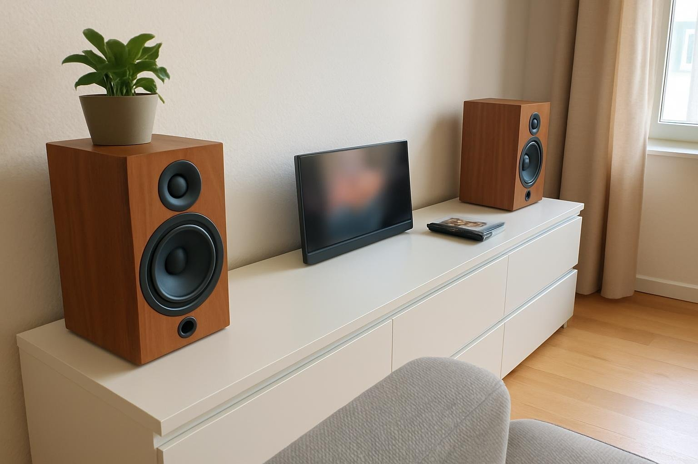

6월 말부터 두 달 쓴 R360 후기예요. 한마디로 음량 걱정은 할 필요가 없는 스피커였네요.

| 형태 | 출력 | 연결 · 전원 | 사용 기간 |
|---|---|---|---|
| 북셸프 · 2채널 | 40W (20W×2) | RCA / AC 전원 | 2개월 |

## 좋았던 점

처음 연결한 날 볼륨을 평소처럼 올렸다가 소리가 너무 커서 놀랐어요. 절반도 안 올렸는데 거실이 차네요. 주말 오후에 청소기 돌리면서 틀어 둬도 가사까지 들리고, 설거지할 때 물소리에도 노래가 안 묻혀요. 그러면서 저음도 넉넉해서 음악이 묵직하게 들려요. 전에 쓰던 북셸프랑 비교해도 거실을 채우는 힘은 뒤지지 않고, 볼륨을 덜 올려도 돼서 오히려 여유가 있어요.

소파에 앉든 식탁에 앉든 소리 크기 차이가 크지 않아서, 자리 옮길 때마다 볼륨 만질 일이 없었어요. 잔잔한 곡도 빈약하지 않고 따뜻하게 들려요. 여름 내내 저녁 먹고 나서 한두 시간씩 플레이리스트를 틀어 뒀는데, 그 시간이 꽤 좋았네요. 주말 아침엔 라디오 앱을 틀어 두는데, 진행자 목소리도 거실 전체에 고르게 퍼져요. 가족 생일에 축하 노래를 틀었을 때도 분위기가 제대로 났고요.

나무 상자에 앞면이 단정해서 거실 가구 옆에 둬도 잘 어울려요. 덩치가 있는데 거실에선 오히려 그게 오디오답게 보여서 마음에 들고, 소파에 앉으면 스피커가 귀 높이쯤 와서 좋더라고요. 책상 위에 올렸다면 덩치 때문에 답답했을 것 같아요. 스피커 위에 작은 화분을 하나 올려 뒀는데 생각보다 잘 어울리네요.

## 아쉬웠던 점

블루투스가 없어요. 저녁에 휴대폰으로 음악 틀고 싶을 때가 많은데 선을 꽂아야 들을 수 있고, 주말에 친구가 놀러 와서 노래 틀어 달라고 할 때도 선 찾느라 분위기가 잠깐 끊겼어요. 선으로 연결하면 휴대폰을 스피커 옆에 둬야 해서, 곡을 바꾸려면 매번 일어나야 했고요.

블루투스 수신기를 달까 한동안 고민하다가, 결국 PC로 음악 트는 습관이 들었어요. 휴대폰에 모아 둔 재생 목록을 PC 쪽에 다시 만드느라 하루 저녁을 꼬박 썼지만, 지금은 크게 불편하지 않아요. PC 쪽 재생 목록은 아직 휴대폰만큼 정리가 안 돼서, 가끔 듣고 싶은 곡이 없을 때는 아쉽네요.

## 정리

휴대폰을 자주 연결한다면 블루투스 없는 건 미리 생각해 두세요. 넉넉한 소리로 음악을 틀어 둘 용도라면 추천해요. 블루투스만 있었으면 흠잡을 데가 거의 없었을 거예요. 두 달 동안 거실에서 TV보다 이 스피커를 더 자주 켰을 정도니까요.
