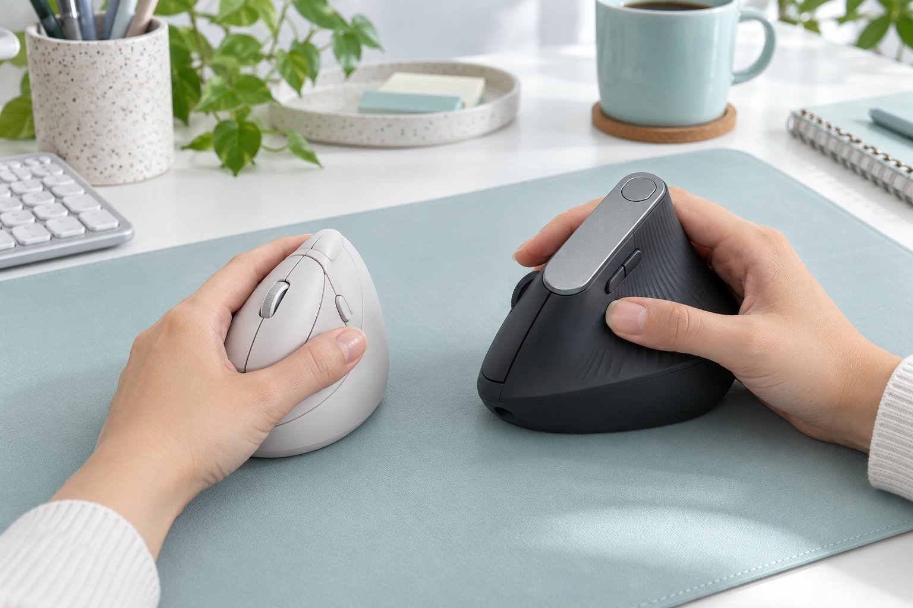
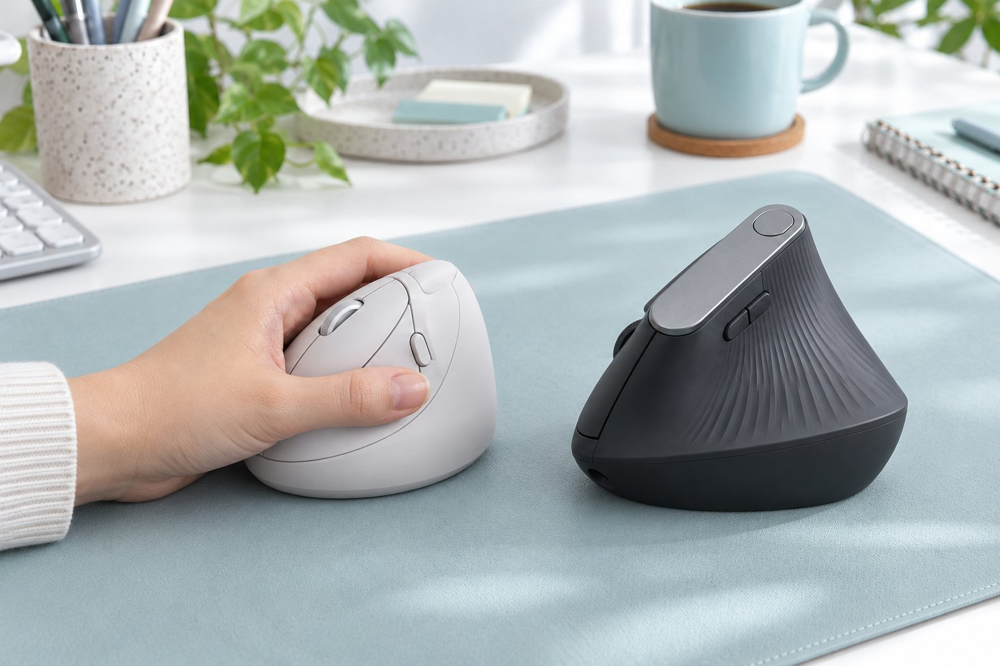

번역과 문서 작성을 하루 여덟 시간씩 하는 사람입니다. 혼자 쓰는 작업실이라 소리 때문에 눈치 볼 일은 없지만, 하루 종일 마우스를 쥐고 있다 보니 손목이 늘 고민이었습니다. 게다가 손이 작은 편이라 큰 마우스는 아예 후보에서 빼고 고르는 편입니다. 이번에 버티컬 마우스를 두 종류 써 보았습니다. Logitech Lift는 두 달 반, Logitech MX Vertical은 한 달을 썼고, 두 제품의 차이를 작은 손 기준으로 정리해 봅니다.

| 제품 | 크기 | 무게 | 연결 | 사용 기간 |
|---|---|---|---|---|
| Lift | 70 × 108 × 71 mm | 125 g | 무선 USB 수신기 · 블루투스 | 2개월 반 · 번역·문서 |
| MX Vertical | 79 × 120 × 78.5 mm | 125 g | 무선 USB 수신기 · 블루투스 | 한 달 · 번역·문서 |

## 쥐었을 때의 크기

작은 손에는 Lift가 맞았습니다. Lift는 길이가 108mm라서 손바닥이 가득 얹히고, 손끝을 뻗으면 버튼이 자연스럽게 닿습니다. 처음 책상에 올려 두고 쥐어 본 순간부터 Lift는 제 손에 맞는 크기라고 느꼈습니다. 반면 MX Vertical은 길이가 120mm에 높이도 78.5mm나 되어서, 손이 작은 저에게는 손끝이 버튼에 겨우 닿았습니다. MX Vertical의 엄지 쪽 버튼은 엄지를 끝까지 뻗어야 눌렸고, 번역하면서 앞뒤 이동을 자주 쓰는 저에게는 그 점이 계속 거슬렸습니다. 손바닥 아랫부분도 Lift에서는 편안하게 받쳐지는데, MX Vertical에서는 약간 뜨는 느낌이었습니다.

겉모습도 비교해 보면 Lift는 곡선이 부드럽고 크기가 얌전해서 작업실 책상에 놓아도 어색하지 않았습니다. MX Vertical은 높이가 있어서 책상 위에서 존재감이 꽤 큽니다. 다만 MX Vertical의 마감이 깔끔하다는 인상은 Lift만큼이나 좋았습니다.

## 손목과 적응

손목이 꺾이지 않는다는 점은 Lift와 MX Vertical 모두 같았습니다. 전에 쓰던 일반 마우스는 오후만 되면 손목이 안쪽으로 비틀려서 뻐근했는데, Lift로 바꾼 뒤로는 저녁까지 손목이 편했습니다. MX Vertical을 쓴 한 달 동안도 손목의 각도는 만족스러웠습니다. 적응에는 Lift가 이틀쯤, MX Vertical이 사흘쯤 걸렸고, 그 사이에는 긴 원문을 스크롤하다가 커서가 엉뚱한 곳으로 가는 일이 몇 번 있었습니다.

정밀한 작업은 두 제품 모두 아쉬웠습니다. 긴 문장에서 단어 하나만 드래그해 선택할 때는 Lift가 일반 마우스보다 느려서 몇 번 놓쳤고, MX Vertical도 마찬가지로 세밀하게 끌어당기는 동작이 손에 익지 않았습니다. 대신 번역 원문과 번역문 창을 오가며 클릭하는 동작에서는 Lift가 클릭이 조용하고 가벼워서 부담이 없었습니다. 손이 큰 분이라면 Lift는 작게 느껴질 수 있고 오히려 MX Vertical이 편할 수 있겠다는 생각이 듭니다.

## 전원과 버튼

전원 방식이 달라서 관리하는 방법도 다릅니다. Lift는 건전지를 넣어 쓰는 방식이라 충전 걱정이 없고, 건전지 하나로 오래간다고 합니다. 다만 건전지를 미리 사 두어야 한다는 점은 알아 두어야 합니다. MX Vertical은 충전식이라 USB-C 선만 있으면 되지만, 최대 4개월마다 한 번은 충전해야 합니다. 한 달을 쓰는 동안 MX Vertical은 충전을 할 일이 없었습니다.

버튼은 Lift가 여섯 개, MX Vertical이 네 개입니다. Lift는 여섯 개 중 앞뒤 이동과 복사·붙여넣기를 지정해 쓰는데 손가락이 닿는 거리에 있어서 편했습니다. MX Vertical은 버튼이 적고 위치도 멀어서, 번역할 때 단축 동작을 지정해 쓰기에는 불편했습니다.

## 정리

두 제품 모두 손목이 편하다는 장점은 같지만, 작은 손에는 Lift를 추천합니다. Lift는 크기와 버튼 위치가 손에 맞았고, MX Vertical은 크기가 커서 버튼까지 손끝이 닿지 않았습니다. 손이 보통이거나 큰 편이라면 MX Vertical도 후보에 올릴 만하지만, 저처럼 손이 작은 사람에게는 쥐어 보고 고르기를 권합니다.
