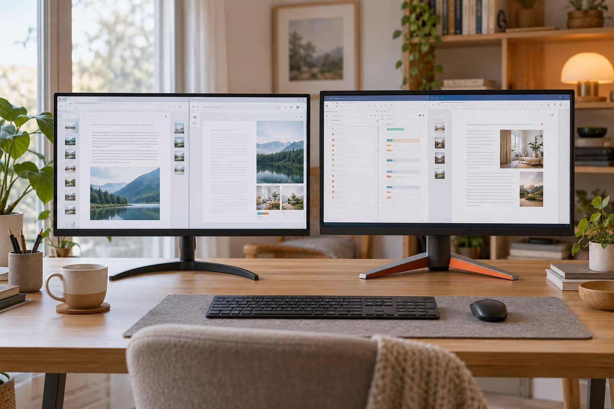

노트북으로 문서와 메일 작업을 하루 다섯 시간쯤 하는 사람입니다. 카페나 공유 오피스에서 일하는 날이 많지만, 집에 돌아오면 노트북에 27인치 모니터를 연결해서 쓰고 모니터와는 60cm쯤 떨어져 앉습니다. 방 밝기는 보통입니다. 집에서 쓸 보조 모니터를 고르다가 같은 27인치 QHD인 LG 27QN600과 BenQ MOBIUZ EX2710Q를 써 보았습니다. 27QN600은 두 달, EX2710Q는 6주를 썼고, 문서 위주로 쓰는 사람 기준으로 정리합니다.

| 제품 | 크기 · 해상도 | 주사율 · 밝기 | 입력 | 사용 기간 |
|---|---|---|---|---|
| 27QN600 | 27인치 · 2560×1440 · IPS · 5ms | 75Hz · 350nit | HDMI 2 · DP 1 | 2개월 · 문서·메일 |
| MOBIUZ EX2710Q | 27인치 · 2560×1440 · IPS · 2ms | 165Hz · 250nit | HDMI 2 · DP 1 | 6주 · 문서·메일 |

## 문서 작업에는 75Hz로 충분합니다

문서와 메일 위주라면 27QN600으로 충분했습니다. 27QN600은 글자가 선명하고 엑셀 표를 넓게 펼쳐도 답답하지 않아서, 노트북 화면만 쓰던 때보다 작업이 훨씬 편해졌습니다. 27QN600은 75Hz라서 마우스 커서가 165Hz만큼 부드럽지는 않았지만, 문서를 쓰는 동안 그 차이를 불편하게 느낀 적은 없었습니다.

EX2710Q는 165Hz여서 화면이 훨씬 부드러웠습니다. EX2710Q는 긴 문서를 스크롤할 때 글자가 끊기지 않고 따라왔고, 커서가 움직이는 모습도 눈에 띄게 매끄러웠습니다. 다만 제가 하는 일이 문서와 메일이라 그 부드러움이 작업 속도로 이어지지는 않았습니다. 전에 쓰던 24인치 풀HD 모니터와 비교하면 27QN600과 EX2710Q 모두 작업 공간이 넓어진 것이 가장 큰 변화였고, 주사율 차이는 그다음이었습니다.

## 밝기는 27QN600이 더 높습니다

27QN600은 350nit이고 EX2710Q는 250nit입니다. 보통 밝기의 방에서 낮에 커튼을 걷고 쓰면 27QN600은 글자가 또렷하게 보였지만, EX2710Q는 화면이 조금 어둡게 느껴졌습니다. 저녁에 조명을 켠 방에서는 EX2710Q도 충분히 밝아서 불편이 없었습니다. 낮 시간에 집에서 일하는 날이 많다면 27QN600이 더 편하겠다고 느꼈습니다.

EX2710Q는 화면은 부드럽지만 더 어둡다는 점이 문서 위주 사용에서는 아쉬움으로 남았습니다. 반대로 게임이나 영상을 즐기는 분이라면 EX2710Q의 165Hz가 큰 차이를 만들겠다는 짐작이 듭니다.

## 스탠드와 연결, 겉모습

스탠드는 EX2710Q가 훨씬 편했습니다. EX2710Q는 높이와 기울기, 회전을 조절할 수 있어서 눈높이에 맞추기가 쉬웠습니다. 27QN600은 높이를 조절할 수 없어서 아래에 책을 받쳐서 눈높이를 맞춰야 했습니다. 노트북과는 두 모니터 모두 HDMI로 연결했고, 연결이 끊기거나 인식이 늦은 적은 없었습니다.

겉모습은 27QN600이 베젤이 얇고 단정한 사무용 인상이고, EX2710Q는 게이밍 모니터답게 각진 디자인이었습니다. 집 책상에 놓았을 때는 27QN600이 더 얌전하게 어울렸습니다. 두 모니터 모두 마감은 깔끔했습니다.

하루를 돌아보면 두 모니터의 차이가 시간대마다 달랐습니다. 낮에 메일을 정리할 때는 27QN600이 밝고 글자가 또렷해서 눈이 편했고, 저녁에 영상을 틀어 놓고 문서를 정리할 때는 EX2710Q의 부드러운 화면이 즐거웠습니다. 문서가 중심이라는 제 기준에서는 27QN600이 앞섰지만, 영상이나 게임을 곁들이는 날이 많아지면 EX2710Q의 주사율이 점점 눈에 들어왔습니다. 결국 어떤 용도를 하나 더 얹을지가 두 모니터를 가르는 기준이었습니다.

## 정리

문서와 메일 위주로 집에서 쓰는 모니터라면 저는 27QN600을 고르겠습니다. 선명하고 밝기도 충분했습니다. 스탠드 조절이 필요하거나 화면의 부드러움을 중시한다면 EX2710Q도 좋은 선택입니다. 문서 중심의 하루라면 27QN600이 더 알맞았다는 점은 두 달 내내 변하지 않았습니다.
