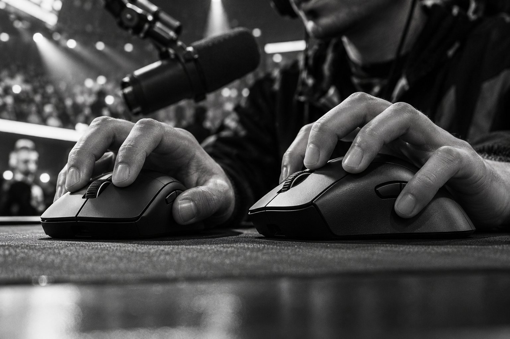

게임 방송을 하루 네 시간쯤 하는 사람입니다. 마이크를 계속 켜 두고 방송하기 때문에 마우스 소리도 같이 들어가는 환경이고, 손은 보통이며 클로 그립으로 쥡니다. 가벼운 무선 마우스를 찾다가 Logitech G PRO X SUPERLIGHT 2와 Razer DeathAdder V3 Pro를 한 달 반씩 번갈아 써 보았습니다. 방송하는 사람의 입장에서 두 제품이 어떻게 다른지 적어 봅니다.

| 제품 | 크기 | 무게 | 연결 | 사용 기간 |
|---|---|---|---|---|
| G PRO X SUPERLIGHT 2 | 63.5 × 125 × 40 mm | 60 g | 무선 USB 수신기 · 유선 | 한 달 반 · 게임 방송 |
| DeathAdder V3 Pro | 68 × 128 × 44 mm | 64 g | 무선 USB 수신기 | 한 달 반 · 게임 방송 |

## 쥐는 느낌과 조작

SUPERLIGHT 2는 손끝 조작이 자유로웠습니다. SUPERLIGHT 2는 60g이라는 무게 덕분에 클로로 쥔 손가락이 가볍게 움직이고, 마우스를 빠르게 밀었다 멈추는 동작이 손에 착 붙었습니다. DeathAdder V3 Pro는 손바닥 지지가 좋았습니다. DeathAdder V3 Pro는 등이 높아서 클로로 쥐어도 손바닥 안쪽을 든든하게 받쳐 주고, 오래 쥐고 있어도 손바닥이 뜨는 일이 없었습니다.

방송이 두 시간을 넘어가면 차이가 더 느껴졌습니다. SUPERLIGHT 2는 손가락만으로 조작하게 되어 후반에 엄지 쪽이 조금 피곤했고, DeathAdder V3 Pro는 손바닥이 받쳐 주는 만큼 후반에도 안정적이었습니다. 반대로 빠른 교전 장면에서는 SUPERLIGHT 2가 한 템포 빠르게 따라오는 느낌이 있었고, DeathAdder V3 Pro는 64g이어도 SUPERLIGHT 2보다 살짝 묵직하게 느껴졌습니다. 전에 쓰던 100g 가까운 마우스와 비교하면 두 제품 모두 팔이 훨씬 덜 피곤했습니다.

## 클릭 소리가 마이크에 들어가는 정도

방송하는 저에게는 클릭 소리가 가장 중요한 비교 항목이었습니다. 두 제품 모두 클릭 소리가 마이크에 들어갔지만 들어가는 모양은 달랐습니다. SUPERLIGHT 2는 높고 또렷한 딸깍 소리가 마이크에 선명하게 잡혔고, 방송을 다시 들어 보면 채팅을 읽다가 누른 클릭도 분명히 들렸습니다. DeathAdder V3 Pro도 소리는 났지만 조금 둔탁한 톤이라 마이크에 들어가도 SUPERLIGHT 2만큼 날카롭게 들리지는 않았습니다.

그렇다고 DeathAdder V3 Pro가 조용하다는 뜻은 아닙니다. 시청자가 클릭 소리를 알아챈 횟수로 보면 두 제품 모두 지적이 있었고, 결국 마이크를 마우스에서 멀리 옮기는 방법으로 해결했습니다. 방송 없이 혼자 게임만 한다면 두 제품의 클릭 소리는 거의 신경 쓰이지 않을 거라고 짐작합니다.

## 배터리와 겉모습

배터리는 SUPERLIGHT 2가 최대 95시간, DeathAdder V3 Pro가 최대 90시간으로 비슷합니다. 한 달 반 동안 SUPERLIGHT 2와 DeathAdder V3 Pro 모두 방송 중에 배터리가 떨어진 적은 없었습니다. 겉모습은 SUPERLIGHT 2가 군더더기 없이 단정해서 방송 책상에 놓아도 깔끔했고, DeathAdder V3 Pro는 한쪽으로 기운 모양이 확실하게 눈에 띄었습니다. 마감은 두 제품 모두 단단하다는 인상이었습니다.

방송을 마치고 영상을 다시 돌려 보면 두 제품의 차이가 한 번 더 드러났습니다. SUPERLIGHT 2로 한 방송에서는 짧은 조준 보정이 많아 클릭 소리가 촘촘하게 들어갔고, DeathAdder V3 Pro로 한 방송에서는 클릭 간격이 넓어서 소리가 덜 거슬렸습니다. 같은 게임을 해도 쥐는 방식에 따라 클릭 횟수가 달라진다는 걸 이번에 알았습니다. 손이 작은 분이라면 DeathAdder V3 Pro의 길이가 부담스러울 수 있을 것 같습니다.

## 정리

손끝으로 자유롭게 움직이는 방송 스타일이라면 SUPERLIGHT 2를, 손바닥이 받쳐 주는 안정감을 원한다면 DeathAdder V3 Pro를 권합니다. 저는 방송 시간이 긴 날에는 DeathAdder V3 Pro로 손이 갔고, 빠른 교전이 많은 날에는 SUPERLIGHT 2를 썼습니다. 클릭 소리가 마이크에 들어간다는 점은 두 제품 모두 같으니 방송을 하신다면 마이크 위치부터 정해 두시길 바랍니다.
