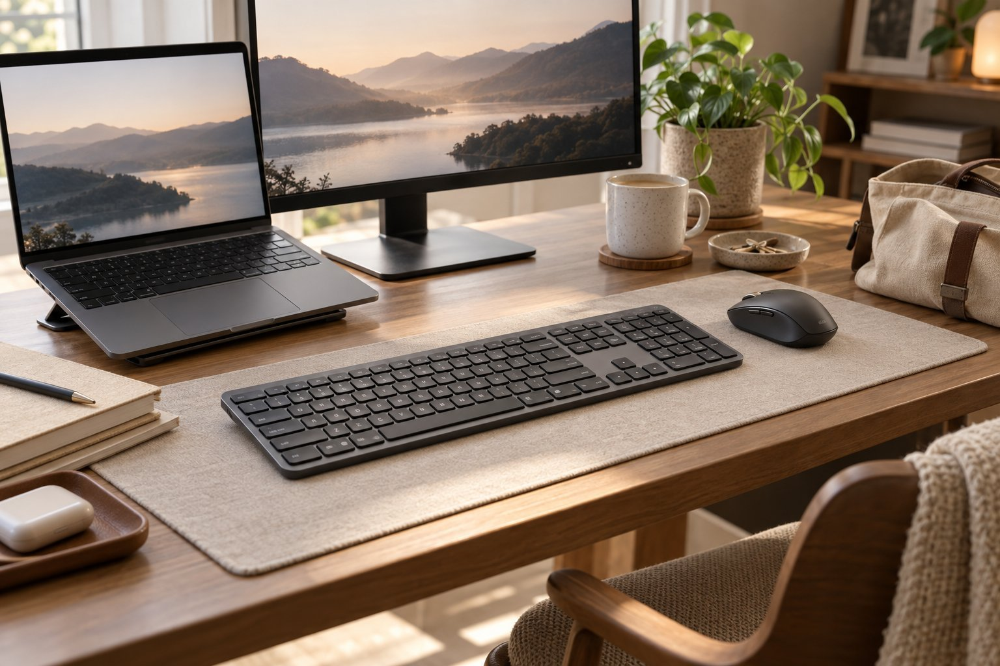
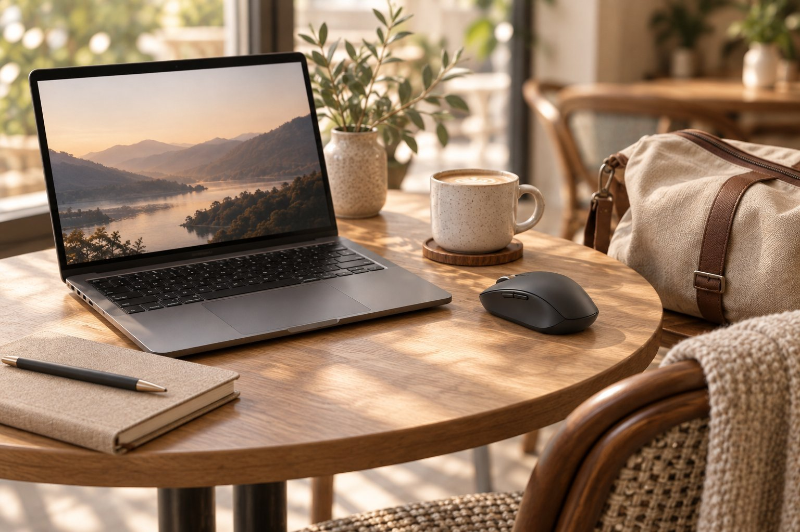
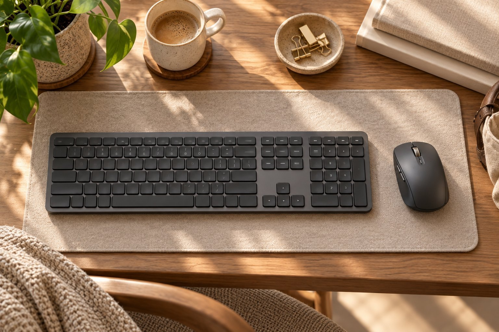

노트북으로 문서와 메일 작업을 하루 다섯 시간쯤 하는 사람입니다. 카페나 공유 오피스에서 일하는 날이 많고, 집에 오면 보조 모니터를 연결해서 모니터와 60cm쯤 떨어져 앉아 일합니다. 조용한 곳에서 쓰는 만큼 소리와 무게가 중요하고, 손은 작은 편이라 마우스는 손끝으로 쥡니다. Logitech MX Anywhere 3S는 4개월, Logitech MX Keys S는 3주를 썼습니다. 카페와 집을 오가는 동안 두 제품이 맡은 역할을 정리합니다.

| 제품 | 크기 | 무게 | 연결 | 사용 기간 |
|---|---|---|---|---|
| MX Anywhere 3S | 65 × 100.5 × 34.4 mm | 99 g | 무선 USB 수신기 · 블루투스 | 4개월 · 카페·집 |
| MX Keys S | 430.2 × 131.63 × 26.1 mm | 810 g | 무선 USB 수신기 · 블루투스 | 3주 · 집 |

## 가방에 들어가는 MX Anywhere 3S

MX Anywhere 3S는 가방에 쏙 들어가는 크기라 매일 들고 다닙니다. MX Anywhere 3S는 카페의 유리 탁자에서도 커서가 잘 움직여서 마우스패드가 필요 없었고, 클릭이 조용해서 공유 오피스에서도 눈치를 보지 않았습니다. MX Anywhere 3S는 블루투스로 노트북에 바로 연결되니 수신기를 꽂을 단자가 필요하지 않다는 점도 좋았습니다. MX Anywhere 3S의 아쉬운 점은 휠 가운데 버튼이 빡빡하다는 것입니다. 휠을 눌러서 쓰는 동작은 손가락 끝에 힘을 꽤 줘야 했습니다.

MX Anywhere 3S를 쓰기 전에는 노트북 터치패드만 쓰다가 손목이 뻐근했는데, 마우스를 쓰고 나서는 오래 문서를 만져도 손목이 한결 편했습니다. 손끝으로 쥐는 저에게 크기가 딱 맞다는 점도 만족스러웠습니다.

## 집에 두는 MX Keys S

MX Keys S는 집의 보조 모니터 앞에 두고 씁니다. MX Keys S는 처음 써 보는 키보드인데, 키가 얕아서 노트북 키보드에 익숙한 제 손에 이질감이 없었습니다. MX Keys S는 첫날부터 오타가 늘지 않았고, 하루 다섯 시간 문서를 쳐도 손가락이 편했습니다. MX Keys S는 소리도 조용해서 밤에 메일을 정리하더라도 주변이 신경 쓸 만한 소리가 나지 않았습니다. 전에 쓰던 두꺼운 기계식 키보드는 키가 깊어서 손목이 뜨고 소리도 컸는데, MX Keys S는 그런 부담이 없었습니다.

반면 들고 다니기에는 큽니다. MX Keys S는 가로가 430.2mm에 무게가 810g이라 가방에 넣기엔 부담이 컸고, 그래서 카페에는 가져가지 않고 집에서만 씁니다. 풀배열이라 숫자 키패드까지 달려 있어 공유 오피스 책상에 올리면 너무 넓다는 짐작도 들었습니다.

## 둘이 함께 쓰는 셋업

두 제품은 같은 회사 제품이라 블루투스 연결이 비슷하게 동작했습니다. 집에서는 MX Keys S와 MX Anywhere 3S 모두 블루투스로 노트북에 연결해 쓰고, 카페에서는 MX Anywhere 3S만 가방에서 꺼내 노트북 키보드와 함께 씁니다. 이렇게 하면 집과 카페 모두에서 같은 마우스 감각을 유지하면서 키보드는 환경에 맞게 쓸 수 있었습니다.

겉모습은 두 제품이 차분한 인상으로 어울렸고, 책상에 올려 두었을 때 통일감이 있었습니다. 마감도 두 제품 모두 단단했습니다.

하루 일과로 보면 아침에는 집에서 MX Keys S로 메일을 정리하고, 오후에는 카페로 가서 MX Anywhere 3S를 꺼내 쓰는 흐름입니다. 두 제품 모두 클릭과 타건 소리가 낮아서 장소가 바뀌어도 소리 때문에 마음 졸이는 일이 없었다는 점이 이 조합의 가장 큰 장점이었습니다. MX Keys S를 쓰고 난 뒤에는 카페에서 노트북 키보드를 쓸 때도 손이 헷갈리지 않았습니다. 손이 큰 분이라면 MX Anywhere 3S를 메인으로 쓰기엔 아쉬울 수 있다는 짐작이 듭니다.

## 정리

카페와 집을 오가며 쓴다면 MX Anywhere 3S는 가방에 넣고 다니는 마우스로, MX Keys S는 집에 두는 키보드로 나누어 쓰는 방식을 권합니다. MX Anywhere 3S는 휴대성과 조용함이 장점이고, MX Keys S는 얕고 조용해서 노트북 키보드와 이질감이 없다는 점이 장점입니다. 카페와 집을 오가는 분이라면 이 나눠 쓰는 방식이 가장 부담이 적었습니다.
