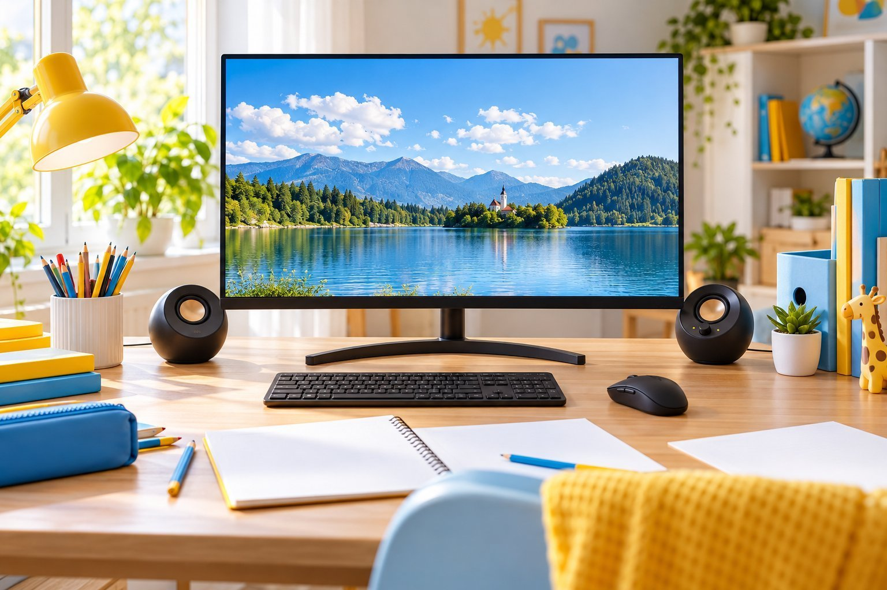
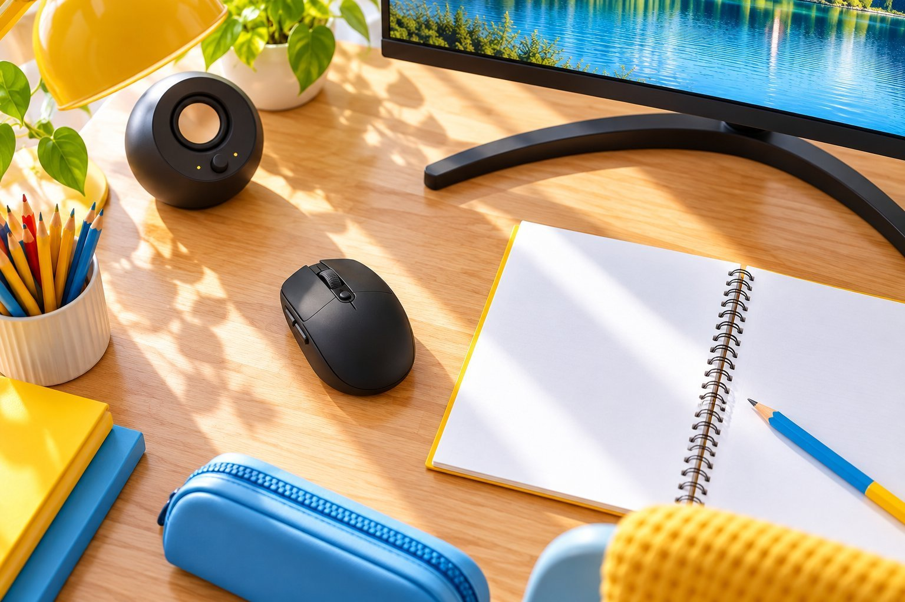
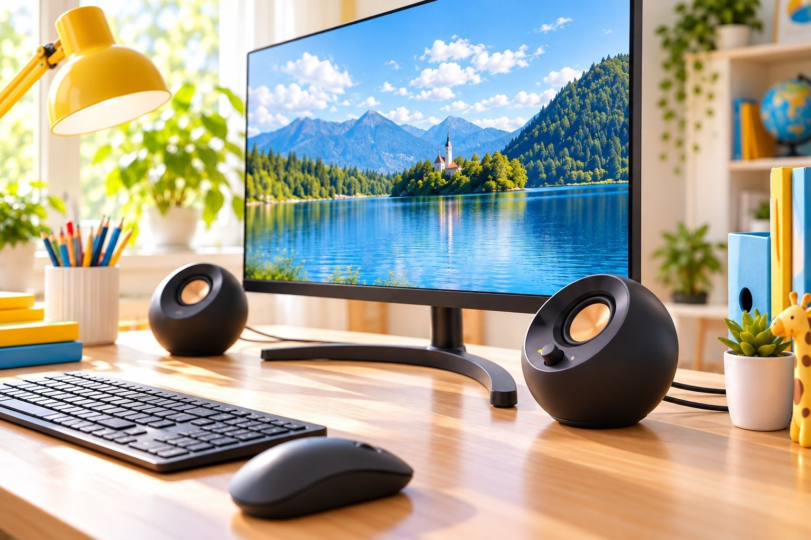

Logitech G304, LG 27QN600, Creative PEBBLE V2 세 가지를 같이 써 온 기록을 남겨요. G304와 PEBBLE V2는 반년 넘게 썼고, 27QN600도 함께 쓰고 있어요. 따로 올린 글이 있지만 세 제품을 한 책상에서 같이 쓰면서 느낀 점을 한 번에 정리하려고 합니다.

| 제품 | 크기 | 무게 | 연결 | 사용 기간 |
|---|---|---|---|---|
| G304 | 62.1 × 116.6 × 38.2 mm | 99 g | 무선 USB 수신기 | 반년 넘게 |
| 27QN600 | 27인치 · 2560×1440 · IPS | — | HDMI 2 · DP 1 | 함께 사용 중 |
| PEBBLE V2 | 116 × 115 × 122 mm | 640 g | 3.5mm · USB(전원) | 반년 넘게 |

## G304: 아이도 편하게 쓰는 마우스

G304는 무선인데 연결이 쉬워요. G304는 수신기를 꽂으면 바로 쓸 수 있어서 설정이 필요 없었고, 선이 없어서 책상 위가 깔끔했어요. 크기가 작은 편이라 아이도 편하게 쥐고 써요. G304의 아쉬운 점은 건전지를 갈아 줘야 한다는 거예요. 건전지 하나로 오래 쓰는 편이지만, 때가 되면 교체해야 하는 번거로움은 충전식 마우스와 다르게 느껴졌어요. 전에 쓰던 유선 마우스는 선이 걸려서 짜증이 났는데, G304는 그런 일이 없어서 좋았어요.

## 27QN600: 숙제와 웹서핑에 선명한 글자

27QN600은 숙제와 웹서핑에 글자가 선명해서 만족했어요. 27QN600은 27인치에 2560×1440이라 화면이 넓어서, 창을 두 개 나란히 놓고 자료를 보며 숙제를 하기에 편했어요. 27QN600은 75Hz라서 빠른 게임에는 아쉬울 수 있지만 웹서핑이나 문서에는 충분했어요.

아쉬운 건 스탠드예요. 27QN600은 스탠드 높이가 고정이라서 아이 눈높이에 맞추기가 어려웠어요. 아이가 쓸 때는 의자 높이를 올리거나 받침대를 놓아야 했어요. 27QN600에서 HDR을 켜면 화면이 뿌옇게 보여서 저는 꺼 두고 쓰고 있어요. 높이를 조절할 수 있는 모니터였다면 더 좋았겠다는 생각이 들어요.

## PEBBLE V2: 선만 꽂으면 끝

PEBBLE V2는 선만 꽂으면 바로 소리가 나서 설치가 쉬웠어요. PEBBLE V2는 작은 음량에서도 소리가 깨끗해서 영상이나 음악을 들을 때 부담이 없었고, 크기가 작아서 책상을 덜 차지했어요. 전에 쓰던 스피커보다 소리가 맑고 책상이 덜 어수선해졌어요.

아쉬운 점은 블루투스가 없다는 거예요. PEBBLE V2로 휴대폰 음악을 들으려면 선을 연결해야 해서 조금 번거로웠어요. 블루투스가 필요한 분이라면 PEBBLE V2보다 다른 모델이 낫겠다는 짐작이 들어요.

세 제품을 놓고 보면 사용 순서도 자연스럽게 정해졌어요. 컴퓨터를 켜면 G304의 수신기가 먼저 잡히고, 27QN600에서 화면이 켜지면 PEBBLE V2는 이미 소리를 낼 준비가 되어 있어서 기다릴 일이 없었어요. 숙제를 하다가 영상 자료를 틀 때도 PEBBLE V2는 볼륨만 올리면 되었고, G304는 선이 없어서 책상 위에서 자유롭게 움직였어요. 다만 아이가 쓰고 나면 27QN600의 높이가 그대로라서 매번 의자를 조절해야 하는 점은 계속 불편했어요. PEBBLE V2는 크기가 작은 만큼 소리가 크지는 않지만 책상 앞에서 듣기에는 충분했어요. 이 세 제품은 단순한 대신 조절 여지가 적다는 공통점이 있어요.

## 세 제품을 함께 쓰며

세 제품을 같이 쓰면서 G304는 선 정리, 27QN600은 화면의 선명함, PEBBLE V2는 단순한 설치가 장점이었어요. G304와 PEBBLE V2는 크기가 작아서 책상이 넓어 보이는 점도 좋았어요. 겉모습은 세 제품 모두 단순해서 어느 책상에 놓아도 어색하지 않았어요. 마감도 깔끔해서 거슬리는 부분은 없었어요. 정리하면 G304보다 27QN600이 책상에서 차지하는 자리가 크지만, 화면의 선명함에서 그만큼 쓸모가 있어요. 쓰다 보니 G304도, 27QN600도, PEBBLE V2도 처음 기대한 만큼 무난했고, 크게 불편한 점이 없다는 것이 이 조합의 가장 큰 장점이라고 느꼈어요. 특별히 화려하지는 않아도 매일 손이 가는 제품들이라 앞으로도 당분간 이 구성을 유지할 생각이에요.
