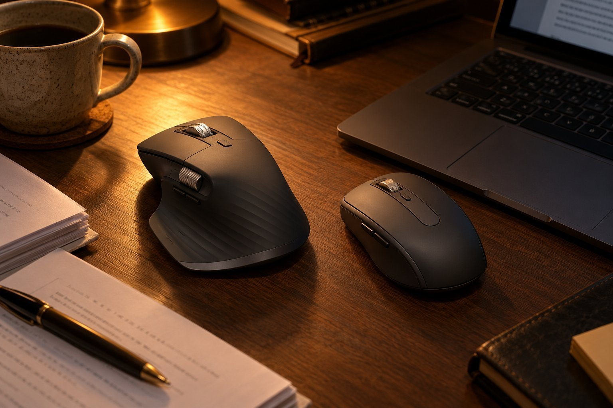
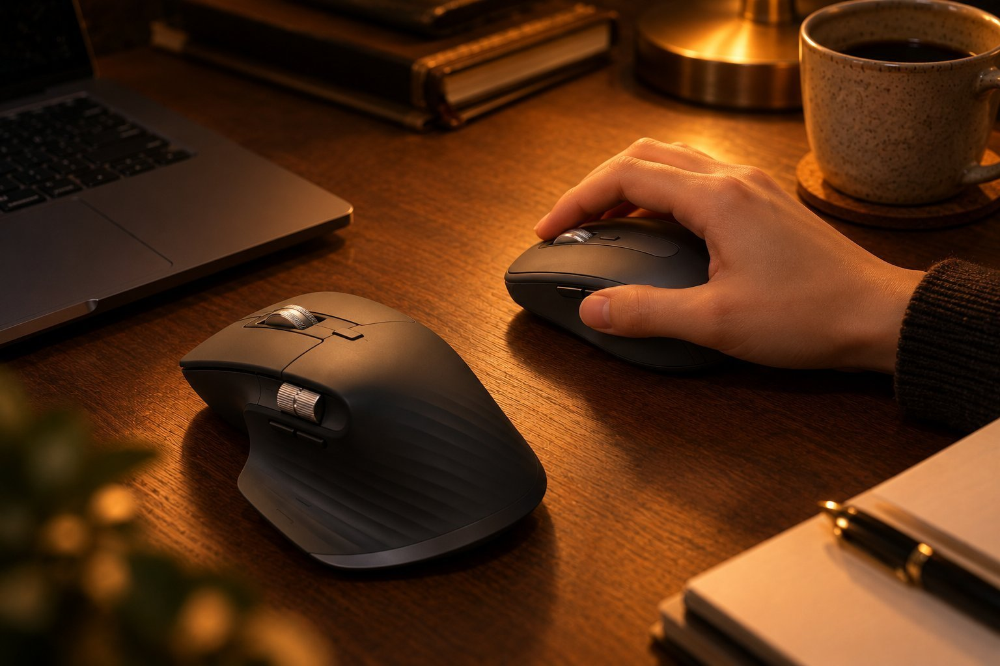
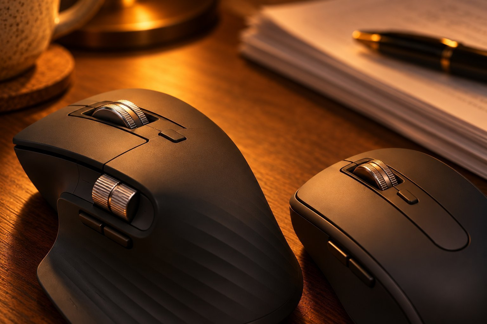

글쓰기와 코딩을 하루 일곱 시간쯤 하고, 밤에도 작업을 이어 가는 사람입니다. 옆방에 가족이 있어서 소리에 민감한 편이라 클릭이 조용한 마우스가 필요했습니다. 손은 작은 편이고 마우스는 손끝으로 쥡니다. Logitech MX Master 3S는 3주, Logitech MX Anywhere 3S는 2개월을 써 보았습니다. 두 제품은 클릭이 조용하다는 점에서는 같지만 크기가 완전히 달라서, 작은 손 기준으로 비교해 봅니다.

| 제품 | 크기 | 무게 | 연결 | 사용 기간 |
|---|---|---|---|---|
| MX Master 3S | 84.3 × 124.9 × 51 mm | 141 g | 무선 USB 수신기 · 블루투스 | 3주 · 글쓰기·코딩 |
| MX Anywhere 3S | 65 × 100.5 × 34.4 mm | 99 g | 무선 USB 수신기 · 블루투스 | 2개월 · 글쓰기·코딩 |

## 크기와 무게

작은 손에는 MX Anywhere 3S가 맞았습니다. MX Anywhere 3S는 길이가 100.5mm로 짧아서 손끝으로 쥐어도 버튼이 자연스럽게 닿고, 책상 위에서 움직일 때 손목이 비틀리지 않았습니다. 반면 MX Master 3S는 크고 무거웠습니다. 폭이 84.3mm, 높이가 51mm여서 손끝으로는 제대로 쥘 수가 없었고, 141g이라는 무게 때문에 코딩하다 마우스를 옮길 때마다 손목에 힘이 들어갔습니다.

전에 쓰던 마우스가 100g 안팎이었는데, MX Master 3S는 그보다 묵직해서 처음 올렸을 때 손이 따라가지 못했습니다. MX Anywhere 3S는 99g으로 이전 마우스와 비슷해서 바꾸고도 위화감이 없었습니다. MX Master 3S가 손이 큰 사람에게 좋은 마우스라는 평이 많은 이유를 쥐어 보고 알았지만, 저에게는 맞지 않았습니다.

## 클릭 소리와 밤 작업

두 제품의 가장 큰 공통점은 클릭이 조용하다는 것입니다. MX Master 3S와 MX Anywhere 3S 모두 저소음 클릭이어서 밤에 옆방 가족이 잠든 시간에도 마음 편히 쓸 수 있었습니다. 어두운 방에서 코드를 읽다가 클릭하는 동작을 반복해도 MX Anywhere 3S는 딸깍 소리가 거의 들리지 않았고, MX Master 3S도 비슷했습니다.

버튼은 MX Master 3S가 일곱 개, MX Anywhere 3S가 여섯 개입니다. MX Master 3S는 앱 전환 버튼과 휠 모드 전환이 있어서 긴 코드를 스크롤할 때 편했지만, 손이 작아 엄지 쪽 버튼이 멀었습니다. MX Anywhere 3S는 버튼이 하나 적어도 모두 손끝이 닿는 거리에 있어서 실제로 쓰는 버튼의 수는 오히려 더 많았습니다. 휠 모드 전환은 MX Anywhere 3S에서도 가능해서 긴 문서를 빠르게 넘길 때 요긴했습니다.

## 충전과 겉모습

두 제품 모두 충전식이고 완충 시 최대 70일을 쓸 수 있다고 합니다. 저는 MX Anywhere 3S를 2개월 쓰는 동안 충전 걱정을 거의 하지 않았습니다. MX Master 3S는 3주를 쓰는 동안 충전할 일이 없었습니다. 겉모습은 MX Master 3S가 크고 묵직해서 책상 위에서 존재감이 컸고, MX Anywhere 3S는 작고 단정해서 노트북 옆에 놓아도 깔끔했습니다.

손이 큰 분이라면 MX Master 3S의 크기가 오히려 장점이 될 수 있겠다는 생각이 듭니다. 반대로 MX Anywhere 3S는 장시간 쓰기에는 손바닥이 뜨는 아쉬움이 있을 수 있어서, 하루 일곱 시간을 쓰는 저도 오후에는 손가락이 조금 피곤했습니다.

하루 일곱 시간을 쓰다 보면 작은 차이가 쌓입니다. MX Anywhere 3S는 가볍고 짧아서 오후가 되어도 팔이 처지는 느낌이 적었고, MX Master 3S는 같은 시간을 쓰면 손목에 피로가 더 일찍 왔습니다. 글을 쓰다가 잠깐 마우스를 잡는 짧은 동작에서도 MX Anywhere 3S는 바로 손에 잡혔고, MX Master 3S는 손을 크게 벌려야 했습니다. 밤 작업에서 소리까지 고려하면 제게는 MX Anywhere 3S가 대부분의 면에서 편했습니다.

## 정리

작은 손으로 조용한 마우스를 찾는 사람에게는 MX Anywhere 3S를 권합니다. MX Master 3S는 조용하다는 장점이 같아도 크기와 무게가 맞지 않았습니다. 두 제품 중에서 고민하신다면 클릭 소리는 같다고 보고 손 크기로 고르시길 바랍니다.
