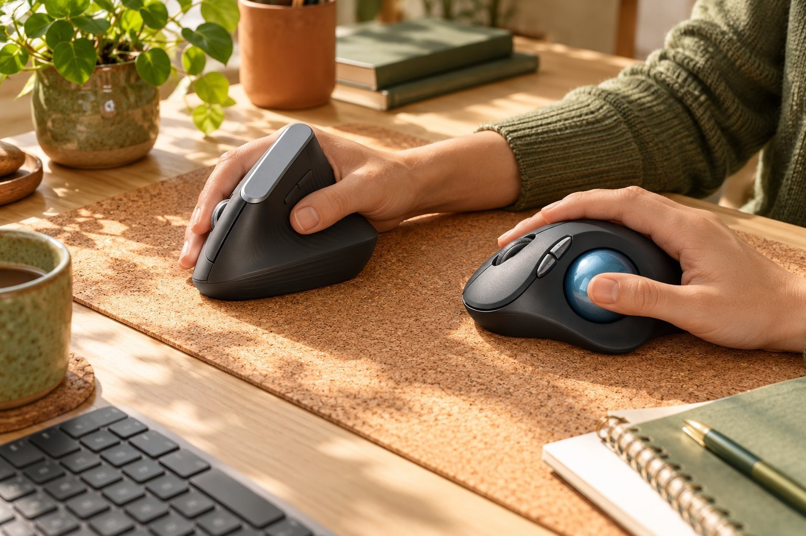

개발 일을 하루 열 시간쯤 하는 사람입니다. 칸막이가 없는 사무실이라 클릭 소리가 조용해야 하고, 오래 앉아 일하다 보니 손목 부담을 줄이는 마우스를 찾게 되었습니다. 손은 아주 큰 편이고 손바닥 전체로 마우스를 감싸 쥡니다. 작년 가을에 Logitech MX Vertical을 3개월 써 본 뒤, 올해 4월부터는 Logitech ERGO M575S를 4개월 가까이 쓰고 있습니다. 손목을 편하게 해 주는 두 방식을 큰 손 기준으로 비교해 봅니다.

| 제품 | 크기 | 무게 | 연결 | 사용 기간 |
|---|---|---|---|---|
| MX Vertical | 79 × 120 × 78.5 mm | 125 g | 무선 USB 수신기 · 블루투스 | 3개월 · 개발 |
| ERGO M575S | 100 × 134 × 48 mm | 145 g | 무선 USB 수신기 · 블루투스 | 4개월 가까이 · 개발 |

## 크기와 쥐는 느낌

큰 손에는 MX Vertical과 ERGO M575S 모두 잘 맞았습니다. MX Vertical은 높이가 78.5mm나 되어 손바닥이 위에서 아래까지 꽉 차게 얹히고, 손목이 꺾이지 않는 상태로 움직일 수 있었습니다. ERGO M575S는 길이가 134mm로 넉넉해서 손바닥 전체가 받쳐졌고, 엄지로 볼을 굴리는 위치도 자연스러웠습니다. 전에 쓰던 일반 마우스는 손바닥 아래쪽이 늘 비어 있었는데, 두 제품 모두 그런 느낌이 없습니다.

다만 MX Vertical은 높이 때문에 키보드와 마우스를 오가는 동작에서 손을 자주 건드렸습니다. 키보드에서 손을 옮길 때 MX Vertical의 윗부분에 손등이 닿아 마우스가 밀리는 경우가 있었습니다. ERGO M575S는 본체가 낮고 움직이지 않아서 그런 일이 없었습니다.

## 손목이 편해지는 방식과 적응

MX Vertical은 적응이 빨랐습니다. 손목을 세워서 쥐는 방식이라 첫날부터 큰 위화감이 없었고, 일주일쯤 지나니 일반 마우스로 돌아가기가 싫어졌습니다. MX Vertical을 쓰는 동안 손목이 꺾이는 느낌이 사라졌고, 오후가 되어도 손목이 덜 뻐근했습니다.

ERGO M575S는 팔과 손목을 아예 움직이지 않고 엄지로 볼을 굴리는 방식입니다. 그만큼 손목과 팔이 편하지만 적응에는 시간이 오래 걸렸고, 저는 2주쯤 걸려서야 커서를 원하는 위치에 놓을 수 있었습니다. 처음 며칠은 창을 옮기는 단순한 동작도 헛돌아서 일이 느려졌습니다. 끌어서 옮기는 작업은 지금도 MX Vertical만큼 정확하지 않지만, 책상이 좁아도 쓸 수 있고 팔을 쓸 일이 없다는 점은 ERGO M575S의 확실한 장점입니다. 적응 기간이 이렇게 차이가 날 줄은 몰랐습니다.

## 소리와 전원

칸막이가 없는 사무실에서는 클릭 소리가 중요합니다. ERGO M575S는 저소음 클릭이어서 옆 사람 눈치를 보지 않고 쓸 수 있었습니다. MX Vertical도 클릭이 부담스러운 편은 아니었습니다. 전원은 ERGO M575S가 건전지 하나로 최대 24개월을 쓸 수 있고, MX Vertical은 충전식으로 최대 4개월입니다. MX Vertical을 쓴 3개월 동안 충전은 한 번이면 충분했고, ERGO M575S는 4개월 가까이 건전지를 갈 일이 없었습니다.

겉모습을 말하자면 MX Vertical은 높이 있는 모양 때문에 책상에 두면 눈에 띕니다. ERGO M575S는 볼이 달린 독특한 외형이라 처음 보는 동료가 어떻게 쓰는지 물어보곤 했습니다. 만듦새는 두 제품 모두 단단했습니다.

하루 열 시간을 앉아 있다 보면 마우스를 바꾼 효과가 오후에 나타납니다. MX Vertical을 쓸 때는 손목이 꺾이지 않아 오후에도 손목이 덜 아팠고, ERGO M575S를 쓸 때는 팔 전체를 책상에 올려 두고도 일을 할 수 있어서 어깨까지 편했습니다. 다만 코드 리뷰에서 줄 단위로 빠르게 선택하는 동작은 MX Vertical이 더 정확했고, ERGO M575S는 엄지가 피곤해지는 날이 있었습니다. 손이 작은 분이라면 두 제품 모두 크게 느껴질 수 있겠다는 짐작이 듭니다.

## 정리

적응이 빠른 쪽을 원하시면 MX Vertical, 팔을 아예 움직이고 싶지 않다면 ERGO M575S를 권합니다. 큰 손에는 두 제품 모두 잘 맞는다는 점은 같으니 적응에 걸리는 시간과 키보드를 오가는 동선을 기준으로 고르시면 됩니다. 저는 지금 ERGO M575S를 쓰고 있지만, 일을 바꿔서 정밀한 드래그가 많아진다면 MX Vertical로 돌아갈 것 같습니다.
