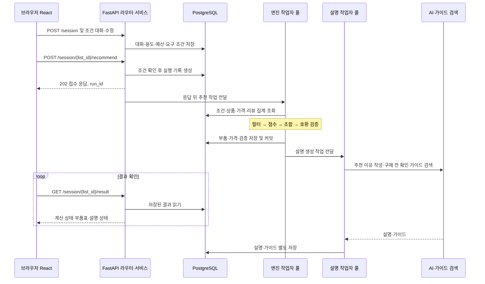
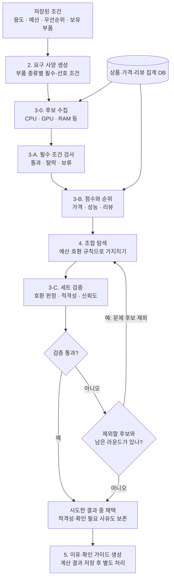
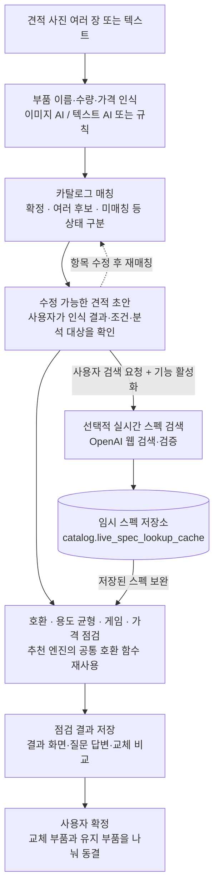
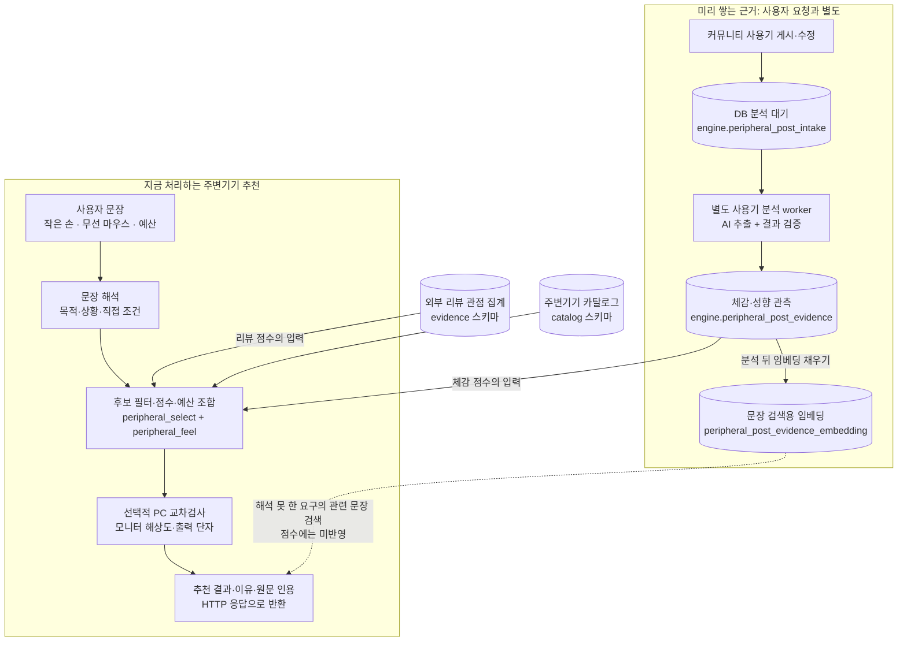

# 시스템 아키텍처 상세

README [6. 시스템 구성 및 DB](../../README.md#6-시스템-구성-및-db)의 구성도를 기능별 처리 흐름으로 나눠 설명합니다. 2026-10-21 소스 코드 기준입니다.

추천 상품, 점수, 금액, 호환 판정은 엔진 코드와 DB 데이터로 정합니다. 언어 모델은 사용자 문장과 견적서를 읽어 정해진 형식으로 옮기고, 결과 설명 문장을 쓰는 데만 씁니다.

## 목차

1. [새 컴퓨터 본체 추천](#1-새-컴퓨터-본체-추천)
2. [받은 견적 점검](#2-받은-견적-점검)
3. [주변기기 추천과 커뮤니티 사용기](#3-주변기기-추천과-커뮤니티-사용기)
4. [데이터 준비와 검색](#4-데이터-준비와-검색)

## 1. 새 컴퓨터 본체 추천

### 1.1 요청 처리 순서

1. 조건 대화는 조건 에이전트 또는 규칙(`slot_rules`)으로 용도·예산을 읽고, 빠진 필수 조건을 다시 묻습니다.
2. 추천 요청은 실행 기록(`engine.recommendation_run`)을 만든 뒤 바로 `202`를 돌려주고, 계산은 API 프로세스 안의 작업자 풀에서 진행합니다.
3. 부품·가격·검증 결과를 먼저 저장하고, 추천 이유와 구매 전 확인 가이드는 설명 작업자가 따로 저장합니다. 설명이 실패해도 부품표는 남습니다.
4. 화면은 저장된 결과를 주기적으로 조회합니다. 조회할 때마다 다시 계산하지 않습니다.

관련 코드: `src/routers/session.py`, `src/services/recommendation_service.py`, `src/services/recommendation_runner.py`

### 1.2 엔진 계산

부품별 순위(3-B)를 먼저 만들고, 한 세트로 묶은 뒤(4), 완성 세트를 검사(3-C)합니다.

| 단계 | 동작 | 코드 |
|---|---|---|
| 요구 사양 | 용도·해상도·게임·예산·업그레이드 대상을 부품별 조건으로 변환 | `stage2_requirement.py` |
| 후보 수집 | DB에서 상품 사양과 가격 관측을 읽음. 보유 부품은 호환 검사용으로만 사용 | `repo/catalog_repo.py`, `owned_parts.py` |
| 필터·순위 | 필수 조건 검사 후 가격·성능·리뷰 점수 계산. 리뷰 점수는 리뷰 관점 집계 사용 | `stage3a_hardfilter.py`, `stage3b_rank.py` |
| 조합·검증 | 상위 후보 조합을 탐색하고 완성 세트의 호환·예산·필수 정보를 검사 | `stage4_optimize.py`, `stage3c_verify.py` |
| 재탐색 | 통과하지 못하면 문제 후보를 빼고 다시 조합. 최대 3라운드 | `research_loop.py` |
| 설명 | 계산된 수치·판정을 문장으로 쓰고 부품 종류별 확인 가이드를 붙임 | `stage5_explain.py`, `rag/care_guides.py` |

검증 통과 조건은 신뢰도 80 이상이면서 적격인 경우입니다. 호환 위반, 예산 초과, 필수 호환 정보 누락이 있으면 신뢰도와 관계없이 통과하지 못합니다. 빠진 스펙은 실시간 스펙 검색으로 이미 저장된 값만 읽어 보완하고, 추천 계산 중에 웹 검색을 하지는 않습니다.

### 1.3 교체와 확정

- 결과 대화(`result_agent` 또는 규칙 경로)는 후보 조회·교체·수량 변경 서비스를 호출하고, 바뀐 세트의 호환을 다시 검사합니다.
- 확정(`POST /lists/{list_id}/confirm`)은 선택 상품과 가격을 서버에서 다시 확인한 뒤, 본체는 `planning.purchase_line`, 주변기기는 `planning.peripheral_line`에 저장합니다.
- 리포트는 이 확정 기록을 읽고, 수정본은 리비전으로 관리합니다.

## 2. 받은 견적 점검

1. `/pc/review-drafts`가 이미지·텍스트에서 부품 목록을 인식합니다. 이미지 일부가 실패해도 성공한 항목은 남고, 이미지 원본은 저장하지 않습니다.
2. 초안(`quote_review_draft`)과 분석 결과(`quote_review`)는 `planning.plan_condition`에 별도 키로 저장해 본체 추천 조건과 섞이지 않게 합니다.
3. DB에 없는 부품은 사용자가 요청할 때만 실시간 검색하고, 결과는 카탈로그와 분리된 임시 저장소에 둡니다([DB 미보유 부품 실시간 스펙 검색](미보유부품_실시간스펙검색_설계.md)).
4. 호환 검사는 본체 추천과 같은 함수(`pc_compat_details`, `pc_link_check`)를 쓰고, 스펙을 모르는 경우는 비호환과 구분해 "확인 못 함"으로 둡니다.
5. 확정하면 교체한 부품은 `purchase_line`, 그대로 둔 부품은 `kept_part_line`에 저장합니다.

관련 코드: `src/routers/pc_check.py`, `src/services/quote_draft_service.py`, `src/services/quote_review_service.py`, `src/services/quote_confirm_service.py`

## 3. 주변기기 추천과 커뮤니티 사용기

### 3.1 추천 경로

- 본체 추천과 달리 요청 한 번에 계산 결과를 바로 돌려줍니다.
- 본체 견적(`pc_list_id`)을 연결하면 해상도와 그래픽카드 출력 단자를 가져와 모니터를 함께 검사합니다.
- 확정하면 `planning.peripheral_line`에 저장합니다.

| 단계 | 동작 | 코드 |
|---|---|---|
| 문장 해석 | 문장을 설정 목록 안의 목적·상황·스펙 조건으로 변환. 직접 말한 조건과 목적에서 풀어낸 조건을 구분 | `peripheral_intent` |
| 결과 화면 명령 | "키보드는 빼줘", "3만원 더 싸게" 같은 명령을 모델 없이 처리 | `peripheral_commands` |
| 요구 사양 | 직접 말한 조건은 거르기 조건, 목적에서 풀린 조건은 선호로만 사용 | `peripheral_requirement` |
| 필터·순위 | 거르기 조건으로 후보를 빼고, 스펙·체감·가격·브랜드·무상 AS 점수를 계산. 근거 5건 미만은 감점 | `peripheral_select` |
| 체감 점수 | 외부 리뷰와 사용기 관측을 합산. 손 크기·용도가 같은 사용자 평가를 먼저 보고 표본이 적으면 전체 평균 쪽으로 보정 | `peripheral_feel` |
| 교차 검사 | 모니터와 PC의 해상도, HDMI·DP 대역폭, USB-C 영상 출력 확인 | `peripheral_cross` |
| 조합 | 전체 예산이 있으면 종류별 상위 5개 조합 중 예산 안 점수 합 최대를 선택. 없으면 최저가 조합에 "예산 초과" 표시 | `peripheral_select` |
| 설명 | 체감 문구, 리뷰 인용, 점수 비중, 순위 생성. 반영하지 못한 말에는 관련 사용기 문장을 찾아 표시 | `peripheral_evidence`, `peripheral_search` |

### 3.2 사용기 분석 경로

- 글을 저장하면 `engine.peripheral_post_intake`에 분석 대기가 기록됩니다.
- 별도 프로세스(`src/workers/peripheral_post_analysis.py`)가 대기 글을 읽어 체감 문장과 작성자 조건(손 크기·용도)을 추출·검증하고, 임베딩과 함께 저장합니다. 삭제·숨김된 글의 근거는 정리합니다.
- 분석이 끝난 뒤의 추천부터 반영됩니다. 분석 기능이 꺼져 있으면 글은 대기 상태로 남습니다.

## 4. 데이터 준비와 검색

DB 스키마 구성은 README [6.2 데이터베이스](../../README.md#62-데이터베이스)에 있습니다.

### 4.1 검색 경로

| 경로 | 방식 | 쓰이는 곳 | 점수와의 관계 |
|---|---|---|---|
| 리뷰 관점 집계 | DB에 저장된 관측을 집계해 요구별 적합도 계산 | 본체의 리뷰 점수, 주변기기의 체감 점수 | 점수 입력 |
| 리뷰 원문 검색 | 질문 임베딩과 `evidence.review_embedding`의 pgvector 코사인 거리 | `/reviews/search`, 관련 리뷰 표시 | 검색 순위일 뿐 점수에 쓰지 않음 |
| 사용기 문장 검색 | `peripheral_post_evidence_embedding`과 단어 일치 순위를 결합 | 반영하지 못한 요구에 관련 사용기 표시 | 설명용 |
| 구매 전 확인 가이드 | `data/pc_care_guides.json`을 메모리에 임베딩해 부품 종류 안에서 검색 | 추천 결과의 구매 전 확인 문구 | 호환 판정과 무관 |

### 4.2 데이터 준비

- `db/setup_all.py`가 마이그레이션 → 기준 데이터 → PC 카탈로그 → 주변기기 카탈로그 → 리뷰 원문 → 관측 → 집계를 차례로 적재합니다.
- 리뷰 원문 임베딩은 `src/workers/review_embedding_batch.py`를 따로 실행해 채웁니다. 원문이 바뀌면 트리거(`0012`)가 기존 임베딩을 지우고 다음 실행 때 다시 만듭니다.
- 커뮤니티 예시 글과 분석 결과는 `db/community_examples_snapshot.py`로 복원합니다.
