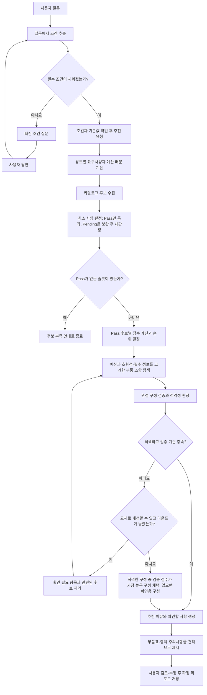

# TrueFit 추천 엔진 알고리즘 설명

작성일: 2026-10-01 · 정책 변경 반영: 2026-10-13 · 기준: 현재 저장소 구현, PC 정책 `computer-rules-v12`(점수 방식 `pc-fit-v2`)

조건 대화·견적 예시 보강일: 2026-10-02

이 문서는 TrueFit이 사용자의 질문을 이해하고, 필요한 조건을 모아 PC 부품 견적을 만드는 과정을 설명한다. 사전 지식 없이 읽는다면 1장의 전체 흐름과 대화 예시, 2.1절의 조건 정리, 8.2절의 완성 견적을 먼저 읽으면 된다. 4장의 점수 계산과 5장의 조합 예시는 그 부품을 선택한 이유를 더 자세히 설명한다. **예시의 상품명·가격·스펙은 계산을 설명하기 위한 가상 데이터이며, 실제 판매 상품이나 성능 측정 결과가 아니다. 대화와 결과 문구도 이해를 돕기 위한 예시이며 실제 응답 문구는 달라질 수 있다.**

현재 실행되는 알고리즘을 기준으로 작성했다. 리뷰 속성 적합도와 같은 후속 설계는 10장에서 따로 설명한다.

2026-10-13 개정에서는 추천 엔진 정책 변경(점수 3축·새 가격식, Pending 승격 삭제와 보완·재판정, RAM 모듈 2개 구성, 조합 적격성, 전력·크기·냉각 여유 기록, 표시 점수 100점)을 반영했다. 근거는 [추천 엔진 수정 계획](history/추천엔진_수정계획_20261012.md)이고 구현 단계와 결과는 [구현 계획](history/추천엔진_수정_구현계획_20261012.md), 전후 비교는 [비교 검증](validation/engine_policy_compare_20261012.md)에 있다. 광고 가산점과 기본 탐색 범위의 전체 후보 풀 확장은 구현하지 않았으므로 이 문서에도 없다.

## 1. 추천은 어떻게 만들어지는가?

**사용자의 요구를 최소 사양으로 바꾸고, 후보별 적합도를 계산한 뒤, 예산 안에서 서로 호환되는 부품 조합을 찾는다.**

예를 들어 “200만 원 안에서 QHD 게임용 컴퓨터를 가성비 위주로 추천해 주세요”라는 요청은 다음 순서로 처리된다.



부품 하나가 좋아도 다른 부품과 함께 사용할 수 없으면 원하는 PC가 되지 않는다. 따라서 **부품별 1위를 모으는 단계와 완성 구성을 선택하는 단계는 다르다.**

| 용어 | 의미 | 예시 |
|---|---|---|
| 슬롯 | 부품을 넣을 자리 | CPU, GPU, RAM, 메인보드, 저장장치, 파워, 케이스, 쿨러 |
| 후보 | 슬롯에 들어갈 수 있는 상품 | GPU A, GPU B |
| 요구사양 | 후보가 만족해야 하는 조건 | GPU 등급 7 이상, VRAM 12GB 이상 |
| 적합도 점수 | 가격·성능·리뷰 세 기준을 합친 후보의 비교 점수 | 가격·성능·리뷰를 합쳐 0.589 |
| 호환성 | 선택한 부품끼리 함께 쓸 수 있는지 | GPU 길이가 케이스 허용 길이 이하 |
| 견적 | 선택한 상품의 수량·가격과 총액을 정리한 구매 구성 | 부품 8종, 총 170만 원 |

PC 부품 이름이 낯설다면 CPU는 계산을 처리하는 중앙처리장치, GPU는 게임 화면 등을 그리는 그래픽카드, RAM은 작업 중인 데이터를 잠시 보관하는 메모리로 이해하면 된다. 메인보드는 부품을 연결하고, 저장장치는 파일을 보관한다. 파워는 전원을 공급하며, 케이스는 부품을 담고, 쿨러는 열을 식힌다. 이 부품들이 함께 작동해야 하므로 각각의 성능과 가격뿐 아니라 서로 맞는지도 확인한다.

QHD는 화면 해상도, 165Hz는 화면이 1초에 갱신되는 횟수를 나타낸다. VRAM은 GPU가 사용하는 전용 메모리다. 이 문서의 목표 해상도·주사율은 요구사양을 정하는 입력이며, 모든 게임에서 그 주사율만큼의 화면을 실제로 그릴 수 있다고 보장하는 값은 아니다.

핵심 선택 로직은 규칙과 수치 계산으로 실행된다. LLM(자연어를 해석하고 문장을 생성하는 AI 모델)은 설정에 따라 조건 대화와 설명 문장 작성에 사용하며, 후보 점수나 호환성 판정을 직접 정하지 않는다.

### 1.1 질문 하나가 견적이 되는 예

사용자가 **PC 본체** 카테고리를 선택한 뒤 다음과 같이 말한다고 하자.

> 사용자: “200만 원 안에서 게임용 컴퓨터를 추천해 주세요.”
>
> 도우미: “새로 만들까요, 업그레이드할까요?”
>
> 사용자: “새로 조립할 거예요. QHD 165Hz로 쓸 거고, 가성비가 중요해요.”
>
> 도우미: “새 조립, 게임용, 최대 200만 원, 가성비 우선으로 정리했어요. 목표는 QHD 165Hz예요. 추천을 받아볼 수 있어요.”

첫 질문으로 알 수 있는 것은 **게임용**과 **예산 상한 200만 원**이다. 기존 컴퓨터의 일부만 바꾸려는지, 새로 한 대를 만드는지는 알 수 없어 구성 방식을 묻는다. 두 번째 답변에서 새 조립·목표 해상도·우선순위가 함께 채워지므로 이미 답한 내용을 다시 하나씩 묻을 필요는 없다.

이후 사용자가 추천을 요청하면 다음처럼 진행된다.

| 순서 | 처리하는 일 | 이 예시에서의 의미 |
|---|---|---|
| 1. 조건 정리 | 대화 내용을 항목별로 정리 | 새 조립 / 게임 / 200만 원 / QHD 165Hz / 가성비 |
| 2. 요구사양 계산 | 용도를 부품이 갖춰야 할 기준으로 변환 | GPU 등급 7 이상, VRAM 12GB 이상 등 |
| 3. 후보 평가 | 카탈로그에서 기준에 맞는 상품(Pass)만 골라 점수 계산 | GPU A와 B가 기준을 충족하며, 가성비 점수는 A가 더 높음 |
| 4. 조합·검증 | 예산 안에서 서로 맞는 한 벌을 찾고 재검사 | GPU A는 케이스 S에 들어가지 않으므로 케이스 L과 조합 |
| 5. 견적 제시 | 선택한 부품·수량·가격·이유·주의사항을 정리 | 총 170만 원, 예산 잔액 30만 원인 구성 제시 |

이 예시의 점수 계산은 4.3절, 조합 비교는 5.2절, 완성된 견적표는 8.2절에 이어진다. **200만 원은 쓸 수 있는 상한이지 반드시 채워야 하는 금액이 아니다.** 조건을 만족하는 조합 중 점수가 높은 구성을 고르므로 예산이 남을 수 있다.

### 1.2 대화 도우미와 추천 엔진의 역할

대화 도우미는 “무엇을 원하는가?”를 정리한다. 예를 들어 “가성비가 중요해요”를 우선순위로, “200만 원 안에서”를 예산 상한으로 옮긴다. LLM을 사용할 수 없는 설정이거나 호출에 실패하면 정해진 표현을 찾는 규칙으로 조건을 추출한다. 선택지로 답하거나 조건 항목을 직접 수정하는 방법도 있다.

추천 엔진은 정리된 조건을 받아 “어떤 부품 조합이 맞는가?”를 계산한다. 최소 사양, 가격, 점수, 호환성은 정해진 규칙으로 판단한다. 마지막으로 설명 단계가 선택 결과와 계산 근거를 문장으로 풀어준다. 따라서 자연스러운 설명 문장이 만들어졌다는 사실만으로 성능이나 호환성이 보장되는 것은 아니며, 견적의 검사 결과와 확인 필요 항목도 함께 읽어야 한다.

## 2. 사용자 조건을 요구사양으로 변환한다

### 2.1 입력을 구조화한다

자유로운 문장을 그대로 부품 검색에 넣는 대신, 추천에 사용할 조건표로 정리한다. 1.1절의 대화는 다음과 같이 정리된다.

| 조건 | 정리한 값 | 값을 얻은 근거 |
|---|---|---|
| 카테고리 | PC 본체 | 사용자가 선택 |
| 구성 방식 | 새 조립 | “새로 조립할 거예요” |
| 용도 | 게임 | “게임용 컴퓨터” |
| 최대 예산 | 2,000,000원 | “200만 원 안에서” |
| 목표 해상도·주사율 | QHD 165Hz | “QHD 165Hz로 쓸 거고” |
| 우선순위 | 가성비 | “가성비가 중요해요” |
| 소음 민감도 | 민감하지 않음 | 별도 답변이 없어 기본값 적용 |
| CPU 브랜드 선호 | 지정 없음 | 별도 답변이 없어 기본값 적용 |

여기서 **사용자가 말한 조건과 시스템이 적용한 기본값은 구분한다.** 소음을 언급하지 않았다는 것은 “소음은 상관없다고 답했다”는 뜻이 아니다. 현재 계산에 기본값을 사용하며, 사용자는 나중에 바꿀 수 있다. 화면에 노출되는 기본값 조건은 가정 상태로 표시한다.

새 조립에서 반드시 필요한 조건은 **구성 방식·용도·최대 예산·우선순위**다. 빠진 필수 조건은 정해진 질문 순서에 따라 묻고, 이미 받은 조건은 유지한다. 업그레이드는 바꿀 부품도 필요하며, 교체 대상에 따라 유지할 부품의 CPU 플랫폼·RAM 규격·파워 용량을 추가로 확인한다. 이때 제공되는 “모르겠어요”도 답으로 받아들이지만, 확인하지 못한 사양은 결과의 확인 필요 사항으로 남을 수 있다.

해상도처럼 기본값이 있는 선택 조건은 사용자가 모두 답하지 않아도 추천을 시작할 수 있다. 예를 들어 목표 해상도를 말하지 않으면 현재 기본값인 FHD 144Hz를 사용하므로, 실제 목표가 QHD라면 추천 전에 수정하는 것이 좋다. **필수 조건을 채웠다는 것은 계산을 시작할 수 있다는 뜻이며, 예산 안에서 원하는 성능을 반드시 달성할 수 있다는 뜻은 아니다.**

조건 변경과 조건 간 충돌도 구분해야 한다. “예산을 180만 원으로 바꿀게요”는 예산 값을 수정하는 요청이다. 반면 낮은 예산과 높은 목표 사양을 함께 지정하면 각각 유효한 조건이어도 가능한 구성이 없을 수 있다. 이 경우 예산 사전 검토와 조합 탐색에서 부족을 안내한다. 현재 흐름이 이런 충돌을 모두 대화로 자동 해결하거나 사용자 동의 없이 예산·목표를 바꾸는 것은 아니다.

“흰색 케이스”처럼 자유 조건으로 기록할 수 있지만 현재 PC 자동 구성 점수에 반영되지 않는 요구도 있다(11장). 조건을 저장하는 것과 선택 기준으로 실제 적용하는 것은 구분해야 한다.

위 조건을 내부 항목 이름으로 표현하면 다음과 같다. 이 표현을 외울 필요는 없으며, 같은 조건이 이후 계산 단계에 전달된다는 뜻이다.

```json
{
  "category": "computer",
  "mode": "build",
  "purpose": "game",
  "budget_max": 2000000,
  "resolution": "QHD_165",
  "priority": "value",
  "noise_sensitive": false,
  "brand_pref": "none"
}
```

용도는 게임·창작·사무·학습·기타이고, 구성 방식은 새 조립 또는 업그레이드다. 우선순위는 성능·가성비·저소음 중 선택한다. 필수 조건을 채운 뒤 사용자가 추천을 요청하면 그 시점의 조건으로 계산한다. 대화 중 조건을 채우는 단계와 실제 추천 계산을 실행하는 단계는 구분된다.

### 2.2 용도와 해상도로 최소 사양을 정한다

게임용 기본 요구는 다음과 같다. `perf_tier`는 성능을 비교하기 위한 1~10 등급이다.

| 목표 | GPU 최소 등급 | CPU 최소 등급 | RAM 최소 용량 | GPU VRAM 최소 용량 |
|---|---:|---:|---:|---:|
| FHD 144Hz | 6 | 6 | 16GB | 8GB |
| QHD 165Hz | 7 | 5 | 16GB | 12GB |
| 4K | 9 | 5 | 32GB | 16GB |

게임 제목이 인식되면 해상도 요구와 해당 게임의 요구 중 **항목별로 더 큰 값**을 사용한다. 예를 들어 QHD 조건의 CPU 하한은 5지만, 사이버펑크의 CPU 하한은 6이므로 최종 CPU 하한은 6이다. 여러 게임을 선택해도 각 항목의 최댓값을 취한다. 표에 없는 게임은 해상도 기준을 유지하고 미해결 조건으로 기록한다.

사무·학습·창작·기타 용도는 별도 프로필을 쓴다. 예를 들어 사무용은 DDR4와 DDR5를 모두 허용하고 저장장치 최소 용량을 500GB로 낮춘다. 창작용은 CPU 등급 8, RAM 32GB를 요구한다.

현재 DB 카탈로그의 CPU·GPU 등급은 제조사 라인업을 등급표로 변환한 대용값이다. 같은 등급 안의 세대·모델 차이를 정밀하게 구분하지 못하며, 목표 해상도의 실제 FPS를 보장하는 값도 아니다. 게임 제목별 요구 등급도 현재 정책에서는 잠정값으로 관리한다.

### 2.3 파워 요구를 계산한다

게임용 기본 정책은 다음과 같다.

```text
예상 소비전력 = CPU 125W + GPU 300W + 기타 75W = 500W
여유를 둔 필요 용량 = 500W × 1.5 = 750W
최소 파워 용량 = 필요 용량 이상인 표준 용량 중 가장 작은 값 = 750W
```

게임용 기본 요구에는 DDR5 RAM, NVMe 저장장치 1,000GB 이상, Gold 이상 파워 등도 포함된다. 이것은 모든 용도에 일괄 적용하는 조건이 아니라 해당 용도의 정책값이다.

이 단계는 **후보를 보기 전의 예상치**를 쓴다. 완성 구성에서는 선택한 CPU의 최대 전력(없으면 TDP)과 GPU 소비전력을 실제 스펙으로 다시 비교한다. 현재 조합 검사의 기본 전력식은 `CPU 전력 + GPU 전력 ≤ 파워 용량 × 0.9`이며, 앞의 요구사양 계산과 달리 기타 부하 75W를 별도로 더하지 않는다.

### 2.4 예산을 슬롯별 참고 금액으로 나눈다

게임용 200만 원 예산의 기본 배분은 다음과 같다.

| 슬롯 | 배분 비율 | 참고 금액 |
|---|---:|---:|
| GPU | 40% | 800,000원 |
| CPU | 18% | 360,000원 |
| 메인보드 | 10% | 200,000원 |
| RAM | 8% | 160,000원 |
| 저장장치 | 7% | 140,000원 |
| 파워 | 8% | 160,000원 |
| 케이스 | 5% | 100,000원 |
| 쿨러 | 4% | 80,000원 |

배분 금액은 후보의 가격 점수를 계산하는 기준이다. GPU가 80만 원을 넘었다고 즉시 탈락하지는 않는다. 최종 조합 탐색에서 전체 구매 금액을 200만 원과 비교한다. 용도가 달라지면 배분도 달라진다.

## 3. 후보를 수집하고 최소 사양을 검사한다

### 3.1 카탈로그를 읽는다

실제 추천 서비스는 DB에서 상품·가격·스펙을 읽는다. 필요한 슬롯에 가격이 확인된 후보가 없으면 `catalog_incomplete` 오류를 반환한다.

개발용 시나리오 실행은 별도 경로다. DB 조회가 실패하거나 카탈로그가 비어 있으면 합성 카탈로그로 대체할 수 있고, `CATALOG_SOURCE=mock`이면 합성 카탈로그를 직접 사용한다. 이 동작을 실제 추천 서비스의 데이터 대체 정책으로 해석하면 안 된다.

### 3.2 예산이 가능한지 미리 살펴본다

요구사양을 모두 충족하는(Pass) 후보 중 슬롯별 최저가를 더한다. RAM은 모듈 2개 구성의 가격으로 센다. 예를 들어 최저가 합계가 210만 원이고 예산이 200만 원이면 예산 부족을 안내한다. 최저가 합계가 예산의 85%를 초과하면 빠듯한 예산으로 분류한다.

이 계산은 슬롯 간 호환성을 아직 보지 않으므로 낙관적인 하한 추정이다. 합계가 예산 안에 들어와도 호환되는 조합이 있다는 뜻은 아니다. 채울 수 없는 슬롯이 있으면 합계에서 빠지므로 그 사실도 별도로 안내한다.

### 3.3 Pass·Fail·Pending으로 구분하고 Pass만 다음 단계로 보낸다

QHD 게임용 GPU를 검사한다고 가정하자.

| 후보 | 성능 등급 | VRAM | 판정 | 이유 |
|---|---:|---:|---|---|
| GPU A | 7 | 12GB | Pass | 두 요구를 모두 충족 |
| GPU B | 8 | 16GB | Pass | 두 요구를 모두 충족 |
| GPU C | 6 | 12GB | Fail | 등급 7 미만 |
| GPU D | 정보 없음 | 12GB | Pending | 성능 등급을 확인할 수 없음 |

여러 조건이 섞이면 `Fail > Pending > Pass` 순서로 판정한다. 알려진 스펙이 조건을 어기면 Fail이고, 위반은 없지만 필요한 정보가 없으면 Pending이다. 가격이 정수가 아니거나 0 이하인 후보도 Pending이다(`PENDING_PRICE_INVALID`).

후보는 다음 규칙으로 다룬다.

- **Pass만 점수 계산·순위·조합 탐색으로 넘어간다.** Pass가 적어도 Pending이나 Fail을 끌어올리지 않는다. 예전의 "Pass가 3개 미만이면 Pending도 남긴다"와 "모두 탈락하면 원래 후보 목록을 그대로 넘긴다"는 삭제했다.
- **Pending은 보류로 보관**하고 누락 키와 사유를 기록한다. 서비스가 실행당 한 번 보완을 시도한다. 이미 저장된 실시간 스펙 검색 결과(만료되지 않았고 거부되지 않은 것)만 읽으며 웹 검색이나 LLM은 부르지 않는다. 저장소가 다루지 않는 항목(예: 성능 등급)은 보완 경로가 없다고 기록한다. 근거 없는 값을 만들어 채우지 않는다.
- 보완된 후보는 **같은 판정을 다시 거치고**, Pass로 확인된 후보만 복귀한다. 보완이 가격이나 구성 입력을 바꾸었으면 점수도 새로 계산한다.
- 보완·재판정 뒤에도 추천 대상 슬롯에 Pass가 하나도 없으면 점수 계산으로 넘어가지 않고 **후보 부족**(`CandidateShortage`)으로 끝난다. 실행은 실패로 기록되고 상태 API가 `candidates_insufficient`와 슬롯별 사유("GPU — 성능 등급 정보가 없는 후보 11개, 요구 등급 미달 8개")를 돌려준다. 견적 비교 기능도 같은 경우를 "비교 불가"로 안내한다.

따라서 하드 필터를 지난 후보는 모두 최소 사양을 확인한 후보다. 이전 문서의 "Fail 후보가 후속 단계로 넘어갈 수 있다"는 설명은 더 이상 맞지 않는다.

RAM은 **모듈 2개 구성**을 한 후보로 판정한다. 2개 키트는 상품 1개(가격·용량 그대로)이고, 낱개 단품은 상품 2개를 사는 구성(가격·용량 2배, 수량 2)으로 바꾸어 본다. 요구 최소 용량은 구성의 총용량으로 판정한다. 예를 들어 32GB를 요구하면 16GB 단품 2개(32GB)와 16GB×2 키트는 Pass, 8GB×2 키트는 Fail이다. 키트에 2를 곱하지 않으며(가격·용량 중복 합산 금지), 모듈이 3개 이상인 키트는 제외하고, 모듈 구성을 읽을 수 없으면 Pending이다. 1개·4개 같은 다른 구성으로 자동 전환하지 않는다(추후 과제).

## 4. 남은 후보의 점수를 계산한다

### 4.1 점수는 세 축의 가중합이다

```text
후보 점수 = clip01( 가격 가중치 × 가격 축 + 성능 가중치 × 성능 축 + 리뷰 가중치 × 리뷰 축 )
```

`clip01`은 부동소수점 오차 등으로 범위를 벗어나는 일이 없도록 0~1로 제한하는 처리다. 중간 계산과 최종 점수는 반올림하지 않는다. 반올림은 사용자에게 보여 줄 때 한 번만 한다(8.4절). 한 후보의 점수는 다른 후보와 무관하므로, 후보를 추가하거나 빼도 같은 후보의 점수는 바뀌지 않는다. 이것은 후보끼리 비교하는 값이며, 성공 확률이나 벤치마크 점수가 아니다.

| 평가 축 | 현재 계산 방식 | 해석 |
|---|---|---|
| 가격 | `B / (B + P)` (P: 상품 가격, B: 슬롯 참고 예산) | 참고 예산과 같으면 0.5, 비쌀수록 0에 가까워지지만 0이 되지 않아 예산 이상의 후보도 구분됨 |
| 성능 | `min(1, 성능 등급 / 10)` | 등급이 높을수록 높음. 등급이 없는 CPU·GPU는 사전 필터가 Pending으로 걸러 이 계산에 오지 않으며, RAM 같은 그 밖의 슬롯은 중립값 0.5 |
| 리뷰 | 후보마다 계산한 리뷰 적합도(0~1, 10장 참고) | 근거가 없으면 중립 0.5. 정숙성 같은 사용자 요구는 이 값 안에서 반영 |

가격은 P와 B가 유한한 양수여야 계산한다. 참고 예산(B)이 없거나 총예산이 0 이하이면 임의의 대체값을 쓰지 않고 오류로 처리한다. 참고 예산이 20만 원일 때 가격 축은 5만 원 0.80, 10만 원 0.67, 20만 원 0.50, 40만 원 0.33, 80만 원 0.20이다. 이전 식(`max(0, 1 − P/B)`)은 20만 원 이상이면 모두 0이었다.

예전의 밸런스·호환여유·소음 축은 삭제했다. 밸런스는 목표 등급을 넘는 높은 성능까지 감점했고, 호환여유는 상대 부품을 고르기 전의 전력 추정이라 실제 조합을 반영하지 못했으며, 소음은 전력·쿨러 유형으로 실제 소음을 추정한 값이었다. 조합의 전력·크기·냉각 여유는 선택된 조합을 기준으로 따로 기록하고(6.4절), 저소음 선호는 리뷰의 정숙성 평가로 반영한다.

**이상 등급**은 점수에 쓰지 않고 병목 힌트에만 쓴다. QHD 게임용의 이상 등급은 GPU 7.5, CPU 5.5이며, 게임 요구가 이보다 높으면 힌트용 이상 등급을 요구 하한까지 올린다. 하드 필터의 **최소 등급**과는 다르다.

### 4.2 사용자 우선순위에 따라 가중치를 바꾼다

| 우선순위 | 가격 | 성능 | 리뷰 |
|---|---:|---:|---:|
| 기본값 | 0.45 | 0.30 | 0.25 |
| 성능 | 0.20 | 0.60 | 0.20 |
| 가성비 | 0.55 | 0.25 | 0.20 |
| 저소음 | 0.40 | 0.25 | 0.35 |

각 행은 합이 1이고 값은 모두 0.01 단위다. 계산 직전에 범위(0~1)와 합계를 다시 검증하며(음수·NaN·합계가 1이 아닌 설정은 오류), 표를 런타임에서 다시 정규화하지 않는다. 이 값들은 산식 검토를 반영한 휴리스틱 초기값이며 최적값으로 검증된 것이 아니다.

`noise_sensitive=true`는 **바깥 가중치를 바꾸지 않는다.** 대신 리뷰 적합도 안에서 정숙성 속성의 중요도를 한 번 높인다. 우선순위가 저소음이어도 같은 조정을 두 번 하지 않는다. 소음 민감을 켠 요청과 끄지 않은 요청의 차이는 리뷰 안의 정숙성 근거에서만 생긴다.

### 4.3 GPU A와 B의 점수를 직접 계산해 보자

조건은 QHD 게임용, 총예산 200만 원, 가성비 우선이다. GPU 참고 예산은 80만 원(200만 원 × 40%), 후보는 둘 다 Pass이며 리뷰 근거는 없어 중립값 0.5라고 가정한다. 아래 값은 실제 점수 함수(`stage3b_rank._score`)로 다시 계산한 것이다.

| 항목 | GPU A | GPU B |
|---|---:|---:|
| 가격 | 600,000원 | 800,000원 |
| 성능 등급 | 7 | 8 |
| 가격 축 | `800000/(800000+600000) ≈ 0.5714` | `800000/(800000+800000) = 0.5` |
| 성능 축 | 0.70 | 0.80 |
| 리뷰 축 | 0.50 | 0.50 |

```text
가성비 가중치(가격 0.55, 성능 0.25, 리뷰 0.20)
A = 0.55×0.5714 + 0.25×0.70 + 0.20×0.50 ≈ 0.5893
B = 0.55×0.5    + 0.25×0.80 + 0.20×0.50   = 0.5750
```

가성비 요청에서는 A가 앞선다. 같은 후보를 **성능 우선** 가중치(0.20 / 0.60 / 0.20)로 계산하면 A는 0.6343, B는 0.6800이므로 B가 앞선다. 사용자 조건이 후보 순위에 반영되는 방식이다.

B의 가격은 이 문서의 이전 판에서 72만 원이었다. 새 가격식과 가중치로 같은 입력을 다시 계산하면 가성비 요청에서도 B(0.5895)가 A(0.5893)를 근소하게 앞서 5.2절과 8장의 이야기(A 선택)와 맞지 않아, 두 후보의 차이가 분명하도록 B를 80만 원으로 바꾸었다. 새 가격식은 비싼 후보의 가격 점수를 0으로 떨어뜨리지 않으므로 같은 가격 차이에서 성능 높은 후보가 더 쉽게 따라붙는다.

### 4.4 감점과 보너스는 없다

점수는 위의 가중합뿐이다. 예전에 더하거나 빼던 값은 삭제했다.

- **Pending 감점 삭제:** Pending은 점수 경쟁에 들어오지 않고 3.3절처럼 보류·보완된다. 높은 점수로 미확인 상태를 상쇄하지 않는다.
- **검사 스펙 결손 감점 삭제:** 필수 정보가 없는 부품은 감점이 아니라 5장의 필수 정보 확인으로 보류·부적격 처리한다. 모든 후보에 값이 없어도 필요한 검사는 생략하지 않는다.
- **RAM 보너스 삭제:** 모듈 2개 구성이 기준이므로 키트가 "총용량이 정확히 같고 모듈이 2개 이상"이라는 이유로 점수를 더 받지 않는다. 가격은 구성 전체 가격으로 계산한다.

점수 계산 후 GPU·CPU는 상위 5개, 다른 슬롯은 상위 3개를 우선 조합 후보로 남긴다. 전체 점수 순위도 보관해 필요할 때 탐색 범위를 넓힌다. 후보 점수 동점은 낮은 가격, 그다음 상품 키 순서로 정한다. 최종 조합 동점 규칙은 다음 장과 같다.

이상 등급이 있는 슬롯에서 1위 후보의 등급이 이상 등급보다 0.5를 초과해 낮으면 병목 힌트를 남긴다. 이것은 등급 기준의 안내이며 실제 FPS 병목 측정은 아니다.

## 5. 예산과 호환성을 함께 고려해 구성을 고른다

### 5.1 탐색의 목표와 제약

```text
목표: 선택한 부품들의 적합도 점수 합을 최대화

조건:
  필요한 슬롯마다 후보 1개 선택
  전체 가격 ≤ 예산
  알려진 스펙으로 확인되는 부품 간 비호환이 없어야 함
  조합의 필수 호환 정보(5.4절)가 모두 있어야 함
  사용자 필수 요구(예: RAM 속도)를 확인된 값으로 만족해야 함
```

기본 8개 슬롯에 GPU·CPU 각 5개, 나머지 각 3개가 있으면 조합 수는 `5 × 5 × 3⁶ = 18,225`개다. 엔진은 **분기 한정 탐색(branch-and-bound)**으로 이를 찾는다.

부품을 하나씩 선택하면서 다음 경우에는 그 뒤의 조합을 더 보지 않는다.

1. 지금까지의 금액에 남은 슬롯의 최저가를 더해도 예산을 초과한다.
2. 선택한 부품 사이에 확정적인 비호환이 있다.
3. 선택한 부품 사이에 필수 호환 정보가 없다(5.4절).
4. 선택한 부품이 사용자 필수 요구를 확인된 값으로 만족하지 못한다.
5. 남은 슬롯에서 최고 점수를 모두 얻어도 이미 찾은 구성보다 점수가 낮다.

아직 고르지 않은 슬롯의 정보는 없다고 가정해 가지를 치지 않는다. 필수 정보 누락과 요구 미충족은 관련된 두 부품이 모두 정해진 시점에, 구매 부품과 업그레이드의 유지 부품을 같은 기준으로 확인한다. 탐색 기록에는 사유별로 가지를 친 수(`pruned_required_missing`, `pruned_requirement_unmet` 등)가 남는다.

최종 점수 합이 같으면 더 저렴한 조합을 선택하고, 가격까지 같으면 슬롯 순서의 상품 키를 비교한다.

### 5.2 부품별 1위를 그대로 고를 수 없는 예

앞의 GPU A와 B(4.3절의 가성비 요청 점수)에 케이스 두 개를 추가한다. 나머지 6개 부품은 총 100만 원으로 고정하고, 관련 호환성 검사는 모두 통과한다고 가정한다. 케이스 점수는 조합 설명을 위해 가정한 값이다.

| 부품 | 가격 | 점수 | 크기 조건 |
|---|---:|---:|---|
| GPU A | 600,000원 | 0.589 | 길이 300mm |
| GPU B | 800,000원 | 0.575 | 길이 270mm |
| 케이스 S | 60,000원 | 0.480 | GPU 허용 길이 280mm |
| 케이스 L | 100,000원 | 0.470 | GPU 허용 길이 330mm |

| 조합 | 고정 부품 포함 총액 | GPU·케이스 점수 합 | 결과 |
|---|---:|---:|---|
| A + S | 1,660,000원 | 1.069 | A의 300mm가 허용 280mm를 초과하므로 제외 |
| A + L | 1,700,000원 | 1.059 | 예산과 호환성 조건을 만족, 채택 |
| B + S | 1,860,000원 | 1.055 | 가능하지만 점수 합이 더 낮음 |
| B + L | 1,900,000원 | 1.045 | 가능하지만 점수 합이 더 낮음 |

GPU 1위와 케이스 1위인 A + S는 함께 사용할 수 없다. 엔진은 케이스를 L로 바꾼 A + L을 선택한다. 나머지 부품의 점수 합은 모든 조합에 같으므로 비교 표에서 생략했다.

이 예에서 가성비 점수가 가장 높은 조합은 170만 원이다. 예산을 모두 쓰는 것 자체가 목표가 아니므로 30만 원이 남을 수 있다. 실제 서비스도 새 조립에서 가성비·저소음 우선이고 예산을 15% 이상 남기면 관련 안내를 제공한다.

### 5.3 상위 후보에서 답을 찾지 못하면?

상위 후보 조합에 예산 내 호환 구성이 없으면 보관한 전체 후보 풀로 넓혀 다시 찾는다. 확대 탐색은 탐색 노드 수 150,000개로 제한하고, 제한 도달 사실을 기록한다.

그래도 예산 내 구성을 찾지 못하면 탐색 범위에서 찾은 가장 저렴한 호환 구성을 반환하고 예산 초과로 표시할 수 있다. 호환 구성 자체를 찾지 못하면 상위 후보에서 확정 비호환 수 등으로 비교한 대체 구성을 반환하고 세트 실패로 표시한다. 이 두 결과는 정상 추천이 아니라 **확인용 구성**이며, 5.4절의 적격성이 `not_recommendable`로 표시된다.

따라서 “모든 상품을 대상으로 항상 전역 최적해를 찾는다”는 설명은 맞지 않는다. 정상 경로는 상위 후보 안에서 최적 조합을 찾으며, 전체 풀 확대는 그 범위에서 해가 없을 때만 실행한다. 확대 탐색이 제한에 도달하면 발견한 최선의 결과가 사용될 수 있다.

### 5.4 필수 호환 정보와 적격성

조합이 정상 추천이 되려면 신뢰도와 별개로 **적격**해야 한다. 적격성은 `recommendable` 또는 `not_recommendable`이며 사유가 코드로 붙는다.

| 사유 | 의미 |
|---|---|
| `compat_violation` | 해당 조합에 적용되는 호환 조건 위반이 1건이라도 확인됨 |
| `required_info_missing` | 그 조합에서 필수 호환 검사에 필요한 값이 구매·유지 부품 중 하나라도 없음 |
| `requirement_unmet` | 사용자 필수 요구(예: RAM 속도)를 확인된 값으로 만족하지 못함 |
| `budget_exceeded` | 전체 금액이 예산을 초과함 |
| `no_compatible_set` | 호환되는 구성을 찾지 못함 |

필수 정보는 **실제 조합과 사용자 요구에 따라** 정해지며, 다른 후보가 그 값을 가졌는지·카탈로그 보유율과 무관하다. 모든 후보에 같은 값이 없어도 필요한 검사는 생략하지 않는다. 주요 항목은 다음과 같다.

| 검사 | 필요한 정보 | 적용 조건 |
|---|---|---|
| 소켓·메모리 규격·메인보드와 케이스 크기·쿨러 소켓 | 양쪽 부품의 규격 | 항상 |
| 메인보드의 CPU 지원 계열(BIOS) | CPU 세대·계열, 메인보드 지원 계열 | 소켓이 확인된 비호환이 아닐 때 |
| 쿨러 높이 | 쿨러 방식·높이, 케이스 허용 높이 | 공랭만 |
| 라디에이터 | 쿨러 라디에이터 크기, 케이스 전면·상단·후면 중 한 곳의 지원 크기 | 수랭만 |
| GPU 길이·두께, 파워 크기·길이 | GPU 치수, 파워 치수, 케이스 허용치 | 항상 |
| 전력 | CPU 최대 전력(없으면 TDP), GPU 전력, 파워 용량 | 항상 (TDP 대체는 누락이 아니라 한계로 기록) |
| GPU 전원 커넥터 종류·개수 | GPU 커넥터 종류, 파워 제공 종류, 실제 연결 경로에 필요한 파워의 커넥터 개수 | GPU가 보조 전원을 쓸 때만 |
| RAM 슬롯 | 모듈 수와 DIMM 슬롯 수, 총용량과 메인보드 최대 용량(두 조건 모두) | 항상 |
| M.2 | 메인보드 M.2 슬롯 수 | M.2 SSD를 고를 때만 (SATA는 비적용) |
| RAM 속도 | RAM·메인보드·CPU의 지원 속도 | 요구사항에 필수 속도(`targets.RAM.speed_mts_min`)가 있을 때만. 현재는 사용자에게서 속도 요구를 받지 않으므로 항상 기존 '확인 필요' 안내다 |

일부 검사만 확인했다고 전체를 통과시키지 않는다. 예를 들어 RAM 슬롯 수는 알지만 메인보드 최대 용량을 모르면 RAM 호환은 확인 불가이며 필수 누락이다. 해당 조합에 쓰지 않는 검사는 '비적용'이고 미확인과 구분한다. 업그레이드에서 유지하는 부품도 구매 부품과 같은 기준으로 확인한다(7장).

필수 정보가 비어 있는 조합은 탐색에서 빼고 다른 유효 조합을 찾는다. 유효 조합이 없으면 같은 보완 경로(저장소 읽기만)로 누락 항목을 **한 번** 채워 보고, 값이 채워졌을 때만 사전 필터부터 한 번 다시 실행한다. 그래도 해결되지 않으면 누락 위치·키·사유가 있는 확인용 구성만 `not_recommendable`로 제공한다. 이 구성의 안내 문장은 코드가 만든다.

## 6. 완성 구성을 검증하고 필요하면 재탐색한다

### 6.1 무엇을 검사하는가?

대표적인 조합 검사는 다음과 같다.

| 검사 | 예시 |
|---|---|
| CPU·메인보드 소켓 | AM5 CPU와 AM5 메인보드인가? |
| RAM·메인보드 규격 | DDR5 RAM을 DDR5 메인보드에 넣는가? |
| 메인보드·케이스 크기 | 케이스가 해당 메인보드 크기를 수용하는가? |
| GPU·쿨러 크기 | GPU 길이와 공랭 쿨러 높이가 케이스 제한 이하인가? |
| 쿨러 소켓·라디에이터 | CPU 소켓을 지원하고 수랭 라디에이터가 들어가는가? |
| CPU 지원 계열 | 메인보드 지원 CPU 계열에 포함되는가? |
| 전력·파워 | CPU·GPU 전력에 비해 파워 용량이 충분한가? |
| 파워·GPU 전원 | 파워 크기·길이와 GPU 전원 커넥터 종류·개수가 맞는가? |
| 메모리·저장장치 연결 | RAM 개수·용량과 M.2 슬롯이 맞는가? |
| 동작 속도 | RAM·SSD가 보드 한계 때문에 낮은 속도로 동작하는가? |

5.4절의 **필수 호환 정보**를 모르면 확인 필요가 아니라 적격성 사유(`required_info_missing`)가 된다. 필수가 아닌 정보(사용자 필수 속도가 없을 때의 RAM 속도 등)를 모르면 확인 필요로 남긴다. RAM 속도 초과나 전원 어댑터 필요도 바로 확정 비호환으로 단정하지 않는다. 출고 BIOS 버전처럼 현재 데이터에 없는 사항은 지원 계열만으로 보장하지 않는다. 수랭 쿨러에서는 쿨러 높이 검사를 비적용으로 두고 라디에이터 검사가 대신한다.

### 6.2 검증 신뢰도와 적격성은 다르다

내부 검증 신뢰도는 `max(0, 100 − 쟁점 감점 합)`이다. 산식과 감점은 바뀌지 않았다.

| 쟁점 | 감점 |
|---|---:|
| 확정 비호환 또는 세트 실패 | 항목당 20 |
| 감점 대상인 확인 필요 항목 | 항목당 6 |
| 예산 초과 | 20 |
| 예산 사용률이 110%를 초과 | 추가 15 |

예산 초과에 해당하는 두 감점이 함께 적용되면 쟁점은 하나로 합치고 감점 합계 35를 유지한다. 이 값은 규칙으로 만든 내부 제어값이며 구매 성공 확률이나 안전 확률이 아니다.

통과 여부는 점수만으로 정하지 않는다.

```text
passed = (신뢰도 ≥ 80) 그리고 적격
적격 = 확인된 호환 위반 없음, 예산 초과 없음, 호환 세트 있음, 필수 호환 정보 모두 있음, 사용자 필수 요구 충족
```

확정 위반이 1건이면 신뢰도는 `100 − 20 = 80`이지만 `passed`는 거짓이다. 예산 초과 하나만 있어도, 필수 정보가 하나 비어도 마찬가지다. 신뢰도는 쟁점 설명과 라운드 비교에 쓰이고, 최종 추천 여부는 적격성으로 정한다. 검증에 필요한 입력(선택된 부품·요구사양·규칙)이 없으면 적격으로 간주하지 않는다.

### 6.3 재탐색 예시

다른 감점은 없고 감점 대상 확인 필요 항목만 있다고 가정하자. 두 구성 모두 적격이다.

```text
1라운드: 확인 필요 4건 → 100 − 4×6 = 76 → 기준 미달
          케이스의 스펙 결손 관련 쟁점을 확인
          이번에 선택한 케이스 후보를 제외하고 다시 조합

2라운드: 확인 필요 3건 → 100 − 3×6 = 82 → 기준 충족
          2라운드 구성을 채택하고 남은 확인 필요 항목을 안내
```

최대 3라운드에는 최초 구성도 포함된다. 매번 후보를 새로 수집하거나 모든 점수를 다시 계산하는 대신, 제외 목록을 적용해 조합 탐색과 검증을 반복한다.

실제 서비스는 확인 필요 쟁점의 감점이 큰 순서로 제외 대상을 찾는다. 그 쟁점에서 스펙이 누락된 슬롯의 **실제로 선택한 후보**를 제외한다. 성능 저하를 피하기 위해 CPU·GPU와 유지 중인 보유 부품은 제외 대상으로 삼지 않는다. 예산·세트 실패만 남아 있거나 바꿀 후보가 없으면 조기에 멈춘다. 종료 조건은 위의 `passed`(적격하고 신뢰도 80 이상)다.

**채택 규칙:** 실행한 라운드 중 적격한 라운드가 먼저, 그 안에서 신뢰도가 가장 높은 라운드를 채택하고, 같으면 앞 라운드를 선택한다. 신뢰도만 높은 부적격 라운드가 적격 라운드를 밀어내지 않는다. 적격한 라운드가 하나도 없으면 채택된 라운드를 `not_recommendable`(확인용 구성)로 표시한다. 개선되지 않은 마지막 라운드가 자동으로 최종 결과가 되는 것은 아니다.

필수 정보 누락은 후보를 하나 빼서 풀리는 문제가 아니므로 이 재탐색 대상이 아니다. 5.4절처럼 같은 보완 경로로 한 번 채워 보고, 값이 채워졌을 때만 처음부터 한 번 다시 실행한다. 이 보완·재실행은 라운드를 새로 만들지 않는다.

### 6.4 전력·크기·냉각 여유는 점수가 아니라 기록이다

선택된 조합(구매 부품과 유지 부품)의 여유를 항목별로 기록한다. 추천 점수·검증 신뢰도·적격성에는 쓰지 않으며, 한 항목의 큰 여유로 다른 항목의 비호환을 상쇄하지 않는다.

| 항목 | 기록하는 값 | 정보가 없을 때 |
|---|---|---|
| 전력 | 호환 검사 여유 `파워 정격 × 0.9 − (CPU + GPU)`(W, CPU 최대 전력이 없으면 TDP로 대체하고 한계를 표시), 요구 산정 기록, 전체 예상 부하 대비 정격 여유 | 기타 구성품 부하의 근거가 없어 전체 여유는 '확인 불가' |
| 크기 | 케이스 허용 GPU 길이·쿨러 높이·파워 길이에서 실제 치수를 뺀 값(mm), GPU 슬롯 여유(칸), 라디에이터 장착 위치 | 값이 없으면 충분한 공간으로 대체하지 않고 '확인 불가' |
| 냉각 | CPU·쿨러·케이스 입력과 장착 조건 | 비교 가능한 냉각 시험 자료가 없으면 '확인 불가'(쿨러·CPU의 TDP 차이로 확정하지 않음) |

각 항목은 `available`·`unavailable`·`not_applicable` 상태와 입력값·단위·출처·계산식을 함께 남긴다. 결과 API의 `margins`와 실행 기록에서 확인할 수 있다.

## 7. 업그레이드는 무엇이 다른가?

업그레이드 모드는 바꿀 부품만 구매 대상으로 삼고, 유지할 부품은 호환성 검사에 사용한다.

예를 들어 “GPU와 파워만 교체, 예산 80만 원”이라면 기본 배분에서 두 슬롯의 비율만 남기고 다시 정규화한다.

```text
GPU 배분 = 0.40 / (0.40 + 0.08) = 약 83.33%
파워 배분 = 0.08 / (0.40 + 0.08) = 약 16.67%

슬롯 참고 예산: GPU 약 666,666원 / 파워 약 133,333원
```

유지할 메인보드·RAM·케이스 등은 구매 총액에 넣지 않는다. 보유 사양을 카탈로그 또는 입력에서 확인해 요구사양을 제한하고, 조합 검사는 유지 부품도 함께 참조한다.

**유지 부품에도 구매 부품과 같은 필수 정보 기준을 적용한다.** 예를 들어 GPU만 교체할 때 유지하는 파워의 용량이나 케이스의 GPU 허용 길이를 알 수 없으면 그 조합은 정상 추천이 아니다. 부품명을 찾지 못했거나 사양을 일부만 입력한 경우도 예외가 아니다. 이때는 확인용 구성을 `required_info_missing`(쓰고 계신 부품의 어떤 값이 필요한지 포함)과 함께 제공하고 모델명을 정확히 알려 달라고 안내한다. 유지 부품 값은 입력할 때 이미 확인한 것이므로 조합 단계에서 다시 보완하지 않으며, 사용자가 정보를 보태 다시 추천받으면 처음부터 다시 평가한다.

현재 CPU·GPU 등급을 알고 있으면 추천 하한을 적어도 그 등급까지 높이고, 현재 사용 중인 같은 제품은 선택에서 제외한다. 다만 등급이 거친 대용값이므로 이 처리만으로 실제 성능 향상을 보장하지는 않는다.

## 8. 추천 이유와 근거를 만든다

### 8.1 선택 결과를 설명한다

부품 선택이 끝나면 다음 정보를 설명으로 만든다.

- 선택한 부품, 총액, 조건과 연결된 추천 이유
- 확인한 스펙과 출처, 남아 있는 호환성 쟁점
- 리뷰 관측 여부와 순위에 사용된 신호
- 어떤 평가 축이 점수에 많이 기여했는지
- 정상 추천인지 확인용 구성인지(적격성)와 그 사유, 전력·크기·냉각 여유 기록

축별 기여도는 선택한 부품들의 `가중치 × 축 값`을 가격·성능·리뷰 축별로 합쳐 백분율로 계산한다. 실제 구현은 음수 기여를 0으로 처리하고, 정수 비율 합계가 100%가 되도록 보정한다. 감점·보너스가 없으므로 이 비율은 점수의 구성 비중이다. 다만 합이 100%인 비율일 뿐이며, 8.4절의 축별 점수·가중 기여분(점)과는 다른 값이다.

부적격(`not_recommendable`)인 구성은 부품표를 진단용으로 보여 주되, 설명 요약 맨 앞에 코드가 만든 안내 문장("정상 추천 조건을 만족하는 구성을 찾지 못해 확인용 구성을 보여 드려요: …")을 붙인다. LLM이 쓰는 문장이 아니다. 이 안내는 추천 시점의 구성 기준으로 한 번 저장되며 부품 교체 뒤 다시 쓰지 않는다. 현재 상태는 결과 API의 `eligibility`가 정확하다.

LLM은 확정된 수치와 부품을 받아 문장을 작성한다. 생성 실패나 초안 검증 실패 시 규칙 템플릿을 사용한다. 실제 서비스는 부품·가격·검증을 먼저 저장하고 설명을 별도로 생성하므로 설명을 만드는 동안에도 부품표를 조회할 수 있다.

실제 PC 검증의 근거는 카탈로그 스펙 출처다. 설명서 검색 RAG는 그 검증 경로에 연결되어 있지 않다. 별도의 사용 가이드 검색은 “구매 전 확인” 문구를 만드는 데 쓰며, 선택 점수나 확정 호환성 판정을 대체하지 않는다.

### 8.2 완성된 견적은 어떤 모습인가?

1.1절의 대화와 5.2절의 조합 예시를 이어서, 나머지 6개 부품의 고정 금액 100만 원을 아래처럼 나누었다고 가정하자. 이 표는 견적의 구성 요소를 설명하기 위한 예시다. 예시에서는 관련 호환성 검사를 모두 통과한 것으로 가정하며, 표에 없는 세부 스펙으로 성능을 입증하려는 것은 아니다.

| 부품 | 선택 상품 | 구매 수량 | 단가 | 품목 금액 |
|---|---|---:|---:|---:|
| CPU | CPU 예시 상품 | 1 | 300,000원 | 300,000원 |
| GPU | GPU A | 1 | 600,000원 | 600,000원 |
| RAM | RAM 예시 키트 | 1 | 140,000원 | 140,000원 |
| 메인보드 | 메인보드 예시 상품 | 1 | 200,000원 | 200,000원 |
| 저장장치 | SSD 예시 상품 | 1 | 140,000원 | 140,000원 |
| 파워 | 파워 예시 상품 | 1 | 150,000원 | 150,000원 |
| 케이스 | 케이스 L | 1 | 100,000원 | 100,000원 |
| 쿨러 | 쿨러 예시 상품 | 1 | 70,000원 | 70,000원 |
| **합계** | | | | **1,700,000원** |

```text
견적 총액 = 선택한 각 상품의 (단가 × 구매 수량)을 모두 더한 값
예산 잔액 = 2,000,000원 − 1,700,000원 = 300,000원
```

RAM의 구매 수량 1은 키트 한 상품을 산다는 뜻이며, 키트 안의 메모리 모듈 개수와는 다르다. 낱개 단품이 선택되면 모듈 2개 구성을 위해 구매 수량이 2로 표시되고 품목 금액은 단가의 2배다. 실제 PC 견적은 카탈로그에 기록된 판매 가격을 사용하며 가격 관측 시점도 함께 제공한다. 총액 계산은 선택 상품 금액의 합이므로 조립비나 배송비 같은 별도 비용이 자동으로 포함된다고 해석하면 안 된다.

부품표와 함께 다음과 같은 설명을 제시할 수 있다.

> “QHD 게임용 기준을 충족하는 후보 중 가성비 점수가 높은 GPU A를 선택했습니다. 저렴한 케이스 S는 GPU A가 들어가지 않아 제외하고, 길이를 수용하는 케이스 L을 선택했습니다. 부품 총액은 170만 원으로 예산에서 30만 원이 남습니다.”

실제 결과에서는 남은 확인 필요 항목도 별도로 제시한다. 예를 들어 출고 BIOS 버전을 확인할 수 없으면 구매 전 확인 사항으로 남긴다. **추천 구성 제시, 내부 검증 기준 통과, 모든 검사 항목 확인 완료는 서로 다른 상태다.** 6장에서 설명했듯 내부 기준을 통과해도 확인 필요 항목이 남을 수 있다.

### 8.3 사용자가 수정하고 확정한다

견적을 본 뒤 “그래픽카드를 GPU B로 바꾸고 싶어요”라고 요청하거나 교체 기능으로 다른 후보를 선택할 수 있다. 교체가 적용되면 현재 선택된 부품을 기준으로 총액과 호환성을 다시 확인한다. 5.2절의 예시에서 GPU A만 B로 바꾸고 케이스 L을 유지하면 총액은 `170만 원 − 60만 원 + 80만 원 = 190만 원`이다. 케이스 S로의 변경까지 자동으로 적용되는 것은 아니다.

부품 교체는 현재 견적을 수정하는 일이고, “예산을 180만 원으로 낮춰 주세요”처럼 조건을 바꾸는 일은 새 조건으로 추천을 다시 받는 일이다. 조건이 바뀌었는데 이전 조건으로 계산한 결과를 그대로 확정하려고 하면 재추천이 필요하다. 교체 후 검사 결과는 갱신하지만 기존 추천 이유 문장 전체를 자동으로 다시 작성하는 것은 아니므로, 바뀐 부품표와 검사 결과를 기준으로 확인한다.

검토를 마치면 로그인한 사용자가 견적을 확정하고 리포트로 저장할 수 있다. 선택 품목이 있고 추천이 완료되어야 하며, PC 선택 금액이 예산을 초과하면 확정할 수 없다. 따라서 5.3절의 예산 초과 대안을 보여 주는 것과 그 대안을 확정하는 것은 다르다. 확정 리포트는 당시 선택한 상품·수량·금액을 저장한 기록이므로, 이후 카탈로그 가격이 바뀌어도 당시 견적 금액을 보존한다. 견적 확정은 주문이나 결제를 실행하는 단계가 아니다.

### 8.4 추천 적합도는 100점으로 한 번만 반올림해 보여 준다

결과 API는 부품마다 `fit`을 준다. `status`는 `scored`(점수 있음)·`legacy_method`(이전 방식으로 만든 결과라 변환하지 않음)·`unavailable`(원본이 없거나 유효하지 않음) 중 하나이고, `scored`이면 `score`(0~100), 축별 `points`·`weight`·`weighted_points`, `method_version`(`pc-fit-v2`)이 따라온다.

- **원본:** 표시값의 원본은 추천 시점에 저장한 리뷰 계산 snapshot의 반올림 없는 점수·축 값·가중치다. DB의 후보 점수 컬럼(`numeric(8,4)`, 소수 넷째 자리)은 기존 저장 계약으로만 남고 표시·평균의 원본으로 쓰지 않는다.
- **한 번만 반올림:** 원본 `x`에 대해 `Decimal(repr(x)) × 100`을 소수 첫째 자리까지 `ROUND_HALF_UP`으로 한 번만 반올림한다. 원본 `0.66449`는 66.4점이다. 네 자리 저장값 `0.6645`에서 거꾸로 66.5점을 만들지 않는다.
- **견적 평균:** `totals.avg_fit_score`는 점수가 있는 선택 부품의 원본 점수를 평균한 뒤 마지막에 한 번만 100점으로 반올림하고 개수를 함께 준다. 부품별 표시 점수나 저장값을 평균하지 않는다.
- **구분:** 새 방식 결과인데 원본이 없거나 유효하지 않으면 네 자리 값으로 대체하지 않고 `unavailable`로 둔다. 이전 방식(v1) 결과는 100점으로 바꾸지 않고 `legacy_method`로 표시한다. 사용자가 교체한 부품도 추천 snapshot 풀에 있으면 그 점수를 쓰고 없으면 `unavailable`이다.
- **다른 값과의 구분:** 부품 카드의 예산 비중(`budget_share`)과 합이 100%인 축별 기여 비율(`explanation.contribution`)은 그대로이며, 새 점수는 `points`·`weighted_points`라는 다른 이름을 쓴다.

4.3절의 GPU A(가성비 요청)는 가격 축 57.1점, 성능 축 70.0점, 리뷰 축 50.0점이며 가중 기여분은 각각 31.4점, 17.5점, 10.0점으로 합해 58.9점이다. (축별 기여분은 각각 원본에서 한 번씩 반올림한 값이라 표시된 값끼리 합하면 반올림 차이가 생길 수 있다.)

## 9. 주변기기는 별도 경로로 처리한다

주변기기 엔진은 모니터·키보드·마우스·스피커를 처리하며 PC 본체와 다른 점수식을 사용한다.

```text
주변기기 점수 = 가격 가중치 × 가격 값
              + 선호적합 가중치 × 선호 충족 비율
              + 데이터충실 가중치 × 검사 스펙 보유 비율
              − Pending 감점
```

가격 값은 해당 종류의 후보 가격 중앙값 `M`을 기준으로 `clamp(1 − 가격/(2M), 0, 1)`로 계산한다. 예를 들어 중앙값이 10만 원이면 10만 원 후보의 가격 값은 0.5, 20만 원 후보는 0이다. 소프트 선호는 충족 1, 미충족 0, 정보 없음 0.5로 계산해 평균한다.

현재 주변기기의 리뷰 가중치는 0이다. 별도 예산이 없으면 종류별 1위를 선택하고, 있으면 각 종류의 상위 5개 조합에서 예산 내 점수 합을 최대화한다. 예산 내 조합이 없으면 그 탐색 범위의 최저가 조합을 선택하고 초과를 기록한다. 모니터는 목표 해상도와 GPU 출력 단자 등을 추가 검사한다.

이 경로는 현재 개발용 파이프라인에 연결되어 있다. 실제 `execute_recommendation()`의 PC 추천 저장 경로에는 주변기기 실행이 연결되어 있지 않다. 주변기기 가격도 판매처·관측일이 확인된 PC 구매 가격과 구분되는 참고가이며 PC 총액에 합산하지 않는다.

## 10. 현재 리뷰 점수와 후속 설계를 구분한다

### 10.1 현재 구현: 리뷰 작성 패턴의 관측 신호

현재 PC 리뷰 축은 리뷰의 정숙성·안정성 평가를 읽어서 계산하는 방식이 아니다. 사전 배치 산출물의 상품별 관측값을 대조군 중앙값과 비교한다.

```text
관측 산출물이 없거나 상품을 찾을 수 없음 → 리뷰 값 0.50
상품 관측이 있고 중앙값의 2배 이상인 지표가 없음 → 0.75
중앙값의 2배 이상인 지표가 하나라도 있음 → 0.25
```

예를 들어 특정 작성 패턴 비율이 10%, 대조군 중앙값이 3%이면 `10% ≥ 2×3%`이므로 리뷰 값은 0.25다. 임계값과 정확히 같아도 해당한다. 이것은 상품 단위의 관측 신호이며 개별 리뷰의 조작 판정이 아니다.

리뷰 가중치가 0.20이면 관측 없음의 기여는 0.100, 기준 미만은 0.150, 기준 이상은 0.050이다. 다른 축이 같아도 이 값으로 후보 순위가 달라질 수 있다. 관측 산출물을 사용할 수 없으면 그 원인을 로그에 남긴다.

### 10.2 후속 설계: 리뷰 속성 적합도

[리뷰 속성 반영 계획](추천엔진_리뷰속성_반영계획.md)과 [리뷰 적합도 계산 알고리즘](추천엔진_리뷰적합도_계산알고리즘.md)은 기존 리뷰 축의 입력을 속성 적합도로 교체하는 설계다. **현재 `stage3b_rank._review_axis()`에는 이 방식이 구현되어 있지 않다.**

설계에서는 긍정 관측 수 `P`, 부정 관측 수 `N`, 중립 사전값 0.5, 완화 계수 `k`로 속성 점수 `Q`를 계산한다.

```text
Q = (P + k×0.5) / (P + N + k)
R = Σ(속성 중요도 α × 속성 점수 Q)
새 최종 점수의 리뷰 기여 = 기존 리뷰 가중치 × R
```

예를 들어 게임 부하에서 정숙성 긍정 14건, 부정 2건, `k=4`이면 `Q=(14+2)/(14+2+4)=0.8`이다. 정숙성 0.8, 발열 관리 0.7, 안정성 0.9에 중요도 0.60, 0.25, 0.15를 적용하면 `R=0.79`이고, 리뷰 가중치 0.20에서 점수 기여는 0.158이다.

이 예시는 후속 설계의 계산이다. 현재 GPU A·B 예시의 리뷰 값 0.5를 자동으로 이 값으로 교체해 해석하면 안 된다. pgvector 검색도 이 설계에서는 설명 근거를 찾는 역할이며 검색 유사도가 추천 점수가 되는 것은 아니다.

## 11. 피드백과 현재 적용 범위

결과 노출·부품 교체 등의 피드백 이벤트와 브랜드 선호 신호를 기록하는 기능이 있다. 반복 행동은 다음 세션에서 선호를 되묻는 데 사용하며, 기록이 쌓였다고 추천 가중치가 자동으로 학습·변경되는 구현은 아니다.

현재 `brand_pref`는 CPU 플랫폼의 소켓 범위를 정하는 데 사용한다. 저장된 다른 슬롯의 브랜드 선호·비선호를 후보 점수에 자동 반영하는 확장은 아직 연결되지 않았다. 관련 내용은 [사용자 선호·비선호 기록 설계](사용자_선호비선호_기록_설계.md)를 참고한다.

또한 `extra`로 저장한 자유 조건은 현재 PC 자동 구성 점수에 반영하지 않는다. “흰색 케이스”처럼 조건을 기록했다는 사실과 실제 선택에 사용했다는 사실을 구분해야 한다.

## 12. 구현을 확인할 때 볼 파일

| 내용 | 구현 파일 |
|---|---|
| 실제 추천 실행·저장 | [recommendation_service.py](../src/services/recommendation_service.py) |
| 개발용 시나리오 파이프라인 | [pipeline.py](../src/pipeline.py) |
| 조건 정의·기본값 | [computer.yaml](../config/categories/computer.yaml), [slots.py](../src/engine/slots.py) |
| 요구사양·정책값 | [stage2_requirement.py](../src/engine/stage2_requirement.py), [computer_verification_rules.yaml](../config/computer_verification_rules.yaml) |
| 후보 수집·DB 카탈로그 | [stage3_0_candidates.py](../src/engine/stage3_0_candidates.py), [catalog_repo.py](../src/repo/catalog_repo.py) |
| 예산 사전 판단 | [feasibility.py](../src/engine/feasibility.py) |
| RAM 모듈 2개 구성 변환 | [ram_config.py](../src/engine/ram_config.py) |
| 최소 사양 필터·후보 부족 | [stage3a_hardfilter.py](../src/engine/stage3a_hardfilter.py) |
| Pending 후보 정보 보완(저장소 읽기) | [catalog_enrichment.py](../src/services/catalog_enrichment.py) |
| 후보 점수·순위 | [stage3b_rank.py](../src/engine/stage3b_rank.py), [score_policy.py](../src/engine/score_policy.py)(축·가격식·가중치 검증) |
| 조합 탐색·호환성 검사·필수 정보 | [stage4_optimize.py](../src/engine/stage4_optimize.py) |
| 조합 적격성 사유·안내 문장 | [eligibility.py](../src/engine/eligibility.py) |
| 전력·크기·냉각 여유 기록 | [build_margins.py](../src/engine/build_margins.py) |
| 완성 구성 검증·재탐색 | [stage3c_verify.py](../src/engine/stage3c_verify.py), [research_loop.py](../src/engine/research_loop.py) |
| 업그레이드 보유 부품 처리 | [owned_parts.py](../src/engine/owned_parts.py) |
| 추천 설명·축별 기여도 | [stage5_explain.py](../src/engine/stage5_explain.py) |
| 표시 적합도(100점)·견적 평균 | [fit_score.py](../src/services/fit_score.py) |
| 정책 변경 전후 비교·고정 시나리오 | [engine_policy_compare.py](../scripts/engine_policy_compare.py), [engine_policy_scenarios.py](../scripts/engine_policy_scenarios.py), [engine_policy_report.py](../scripts/engine_policy_report.py), [결과 문서](validation/engine_policy_compare_20261012.md) |
| 리뷰 관측 조회 | [review_repo.py](../src/repo/review_repo.py) |
| 주변기기 선택·정책 | [peripheral_select.py](../src/engine/peripheral_select.py), [peripherals.yaml](../config/peripherals.yaml) |
| 탐색·검증·감점 상수 | [config.py](../src/config.py) |

정책 숫자가 바뀌면 2·4·6장의 표와 계산 예시도 함께 갱신해야 한다(4.3절의 예시는 `stage3b_rank._score`로 다시 계산한다). 개발용 시나리오는 검증 결과를 시나리오에서 주입할 수 있으므로, 실제 서비스 검증을 확인할 때는 `verify_set()` 대신 `verify_build()` 호출 경로를 확인한다.
